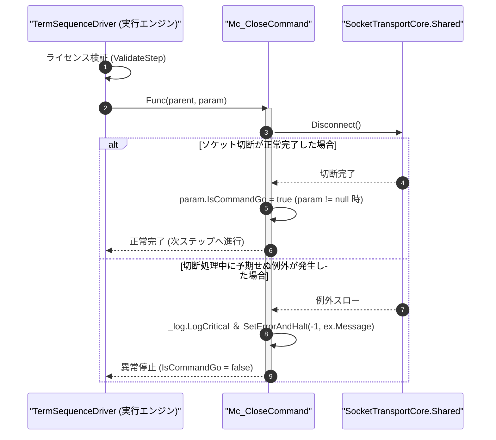

# コマンドリファレンス：Mc_Close

## 概要

**Mc_Close** は、`Mc_Open` により開設された MELSEC MC プロトコル（TCP・バイナリ 3E フレーム）用の TCP 通信ソケットを `SocketTransportCore.Shared.Disconnect()` により安全に切断し、ネットワークリソースを解放する通信制御系コマンドです。
一連の PLC 通信シーケンスの終了時や、判定分岐後の終了処理においてソケット接続を確実にクローズする用途で使用します。

---

## 💡 書式・パラメータ仕様

### コマンド構文

```csv
,SEQUENCE, [ステップキー], Mc_Close
```

### パラメータ（引数）一覧

| 引数位置 | 引数名 | 必須/任意 | 説明・制約 |
| :--- | :--- | :---: | :--- |
| （引数なし） | - | - | `ParameterSpec` 上の定義引数は 0 個です。接続中の TCP 通信ソケットを切断しリソースを解放します。 |

---

## 🔄 特殊置換規約・分岐規約の適用

本コマンドの引数における特殊記法および解釈ルールです。
* **動的置換（`$`）**: 本コマンドは引数を取らないため、引数に対する `$PARAMキー$` 動的置換は適用されません。（適用可能な引数: 非適用）
* **ジャンプ先指定（`#`）**: 本コマンドはジャンプ制御を行わないため適用されません。（適用可能な引数: 非適用）
* **共通コマンド指定（`@`）**: 本コマンドは外部マクロを呼び出さないため、共通コマンド呼び出し記法は適用されません。（適用可能な引数: 非適用）
* **カンマのエスケープ**: 本コマンドは引数を取らないため適用されません。
* **エイリアス（別名）**: `Analysis_Mc_Close`, `Sqn_Mc_Close`

---

## 💡 動作例（正しい構文での記述例）

### スクリプト記述例

※COMMAND ブロック配下の子要素行（PARAM, SEQUENCE）は必ず行頭カンマから開始し、スペースインデントや行末コメント（`;`）は記述しないでください。

```csv
COMMAND, "SAMPLE_MC_CLOSE", ""
; 1. 回線オープン（TCP ポート 5000）
,SEQUENCE, 010, Mc_Open, "192.168.1.10", "5000", "TCP"
; 2. ビットデバイス M100〜M101 へ一括書込
,SEQUENCE, 020, Mc_WriteBit, "M100", "1,0"
; 3. 回線切断・リソース解放
,SEQUENCE, 030, Mc_Close
,SEQUENCE, 040, Exit
```

### 実行時の挙動・変数変化

* **実行前の状態**: `Mc_Open` により `SocketTransportCore.Shared` の TCP ソケット接続が確立され、`Mc_WriteBit` によるビット書込が完了している状態。
* **実行後の状態**: ステップ `030` の `Mc_Close` により `SocketTransportCore.Shared.Disconnect()` が呼び出されて TCP ソケットが安全に切断・解放され、`param.IsCommandGo = true` となってステップ `040` の `Exit` で正常終了します。

---

## 🔄 動作フロー（シーケンス図）



---

## 🚫 エラーハンドリング・安全設計（仕様制限）

入力データの異常や実行時エラーに対し、解析・実行エンジンが実行するセーフティ規約です。

1. **引数仕様と `null` パラメータ耐性**:
   - `ParameterSpec` は引数 0 個として定義されており、統一コマンド検証パイプライン経由で余剰引数が渡された場合はエラー停止します。また、`Func` 直接呼び出し時は `param == null` の場合でも `NullReferenceException` を起こさず安全に `Disconnect()` のみを実行します。
2. **ソケット切断時の例外防御**:
   - 未接続状態での重複呼び出し時もエラーにならず安全に完了します。万一ソケット破棄処理中に予期せぬ例外が発生した場合は、`catch` 節で `_log.LogCritical` に記録し、`param?.SetErrorAndHalt(-1, ex.Message)` によりクラッシュを防いで安全停止します。

---

## 🧪 ユニットテスト仕様

本コマンドクラス（`Mc_CloseCommand.cs`）に実装されている `RunUnitTest()` メソッドが検証するユニットテストの仕様です。

### テスト実行前提条件

* **実行トリガー**: `RunUnitTest()` メソッドの呼び出し
* **有効化条件**: システム全体の最小ログレベル（`ErrorLogger.MinimumLevel`）が `LogLevel.Test` であること（それ以外の場合は無効化ガードにより早期リターン）
* **検証結果出力**: `_log.LogTest` によるログ出力。検証失敗時は `_log.LogError`、予期せぬ例外発生時は `_log.LogCritical` で記録し、`finally` ブロックで `SocketTransportCore.Shared.IsSimulationMode` を開始前の状態へ復元します。

### テストケース一覧

| No | テストカテゴリ | テスト条件（入力値） | 期待される結果（出力値） | 検証の目的 / 観点 |
| :---: | :--- | :--- | :--- | :--- |
| **1** | 正常系 | `SocketTransportCore.Shared.IsSimulationMode = true` 環境下で引数なしの `Mc_Close` を `Func(null, param)` で実行 | `!param.HasError` かつ `param.IsCommandGo == true` となる | MC プロトコル用ソケット回線の正常切断および状態更新の検証 |
| **2** | 異常系 | `Func(null, null)`（`param == null`）を指定して実行 | 例外を発生させず安全に完了し、`!SocketTransportCore.Shared.IsConnected` が維持される | `null` パラメータ入力時の `NullReferenceException` 防御検証 |
