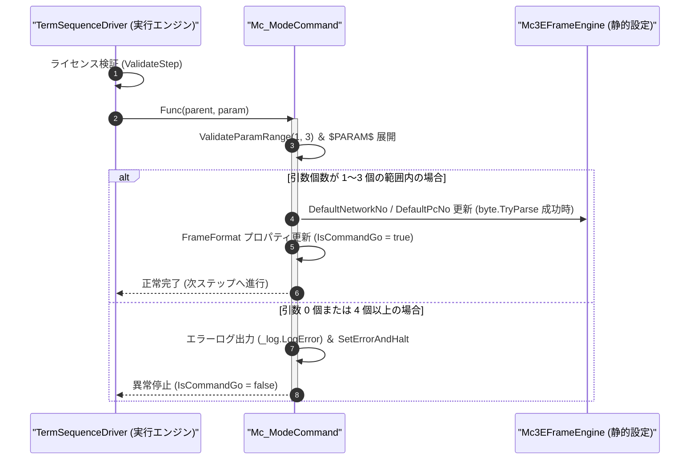

# コマンドリファレンス：Mc_Mode

## 概要

**Mc_Mode** は、MELSEC MC プロトコル（ **TCP・バイナリ 3E フレーム専用** ）における交信経路情報（ネットワーク番号、PC 番号）およびフレーム形式プロパティを動的に変更する通信設定系コマンドです。
PLC との通信電文を送出する前に、アクセス先ネットワークや局番をマクロ上から切り替える用途で使用します。

> 💡 **補足**: 現行の `TermAnalysis.MelcoMC` エンジン（`Mc3EFrameEngine`）は **TCP・バイナリ 3E フレーム専用** で動作します（UDP および ASCII 3E フレームの電文構築・解析は未実装です）。また、本コマンドは **第 1 引数の指定が必須** です。

---

## 💡 書式・パラメータ仕様

### コマンド構文

```csv
,SEQUENCE, [ステップキー], Mc_Mode, [NetworkNo], "[PcNo: 255]", "[Format: Binary]"
```

※ **最低 1 引数の指定が必須** です（引数 0 個または 4 個以上は `ValidateParamRange(1, 3)` によりエラー停止します）。

### パラメータ（引数）一覧

| 引数位置 | 引数名 | 必須/任意 | 説明・制約 |
| :--- | :--- | :---: | :--- |
| 第 1 引数 | `NetworkNo` | **必須** | 宛先ネットワーク番号（`0`〜`255` の整数文字列、例: `"0"`＝自局ネットワーク）。`byte.TryParse` 成功時のみ `Mc3EFrameEngine.DefaultNetworkNo` を更新し、空文字 `""` や範囲外・非数値文字列の場合は現在値を維持します。 |
| 第 2 引数 | `PcNo` | 任意 | 宛先 PC 番号（`0`〜`255` の整数文字列、省略時既定値: `"255"`［`0xFF`：自局アクセス］）。`byte.TryParse` 成功時のみ `Mc3EFrameEngine.DefaultPcNo` を更新し、空文字や範囲外・非数値の場合は現在値を維持します。 |
| 第 3 引数 | `Format` | 任意 | フレーム形式プロパティ指定（省略時既定値: `"Binary"`。先頭が `"A"` で始まる場合は `McFrameFormat.Ascii`、それ以外は `McFrameFormat.Binary` を `Mc_ModeCommand.FrameFormat` に設定しますが、実通信の電文構築・解析エンジンは **バイナリ 3E 専用** です）。 |

---

## 🔄 特殊置換規約・分岐規約の適用

本コマンドの引数における特殊記法および解釈ルールです。
* **動的置換（`$`）**: 引数内で `$PARAMキー$` のように記述すると、実行時に変数プール（PARAM）の値へ動的置換されます。（適用可能な引数: 全引数対応）
* **ジャンプ先指定（`#`）**: 本コマンドはジャンプ制御を行わないため適用されません。（適用可能な引数: 非適用）
* **共通コマンド指定（`@`）**: 本コマンドは外部マクロを呼び出さないため、共通コマンド呼び出し記法は適用されません。（適用可能な引数: 非適用）
* **カンマのエスケープ**: 引数自体にカンマを含める場合は、必ず `"..."` と二重引用符で囲んで記述します。
* **エイリアス（別名）**: `Analysis_Mc_Mode`, `Sqn_Mc_Mode`

---

## 💡 動作例（正しい構文での記述例）

### スクリプト記述例

※COMMAND ブロック配下の子要素行（PARAM, SEQUENCE）は必ず行頭カンマから開始し、スペースインデントや行末コメント（`;`）は記述しないでください。

```csv
COMMAND, "SAMPLE_MC_MODE", "RESULT_D0"
,PARAM, "RESULT_D0", Work, "D0読出結果", ""
; 1. 自局アクセス（Net:0, PC:255）・バイナリ 3E 形式を設定
,SEQUENCE, 010, Mc_Mode, "0", "255", "Binary"
,SEQUENCE, 020, Mc_Open, "192.168.1.10", "5000", "TCP"
; 2. バイナリ 3E フレームで D0 から 1 ワード読出し RESULT_D0 へ格納
,SEQUENCE, 030, Mc_ReadWord, "D0", 1, "RESULT_D0", "DEC"
; 3. 読出値が 0 以上か判定（不成立時は #NG_PROC# へ分岐）
,SEQUENCE, 040, Judge, "GE", "$RESULT_D0$", "0", "#NG_PROC#"
,SEQUENCE, 050, Mc_Close
,SEQUENCE, 060, Exit, "$RESULT_D0$", 0
; 条件不成立時のクローズ＆異常終了経路
,SEQUENCE, #NG_PROC#, Mc_Close
,SEQUENCE, 080, Exit, "NG", -1
```

### 実行時の挙動・変数変化

* **実行前の状態**: Term 通信エンジンが初期化され、変数プール（`PARAM`）に `"RESULT_D0"` が定義されている状態。
* **実行後の状態**: `Mc_Mode` により通信を行わずメモリ上の `DefaultNetworkNo = 0`、`DefaultPcNo = 255`、`FrameFormat = Binary` が更新されます。TCP 接続確立後に `D0` の 10 進読出値が `"RESULT_D0"` へ格納され、`0` 以上であれば回線を閉じて正常終了し、未満であれば `#NG_PROC#` へ分岐して回線切断後にエラー終了します（※通信タイムアウト時はステップ `030` で即座に停止します）。

---

## 🔄 動作フロー（シーケンス図）



---

## 🚫 エラーハンドリング・安全設計（仕様制限）

入力データの異常や実行時エラーに対し、解析・実行エンジンが実行するセーフティ規約です。

1. **引数個数バリデーション保護**:
   - 引数が省略された場合（0 個）または 4 個以上指定された場合は、`ValidateParamRange(1, 3)` により `_log.LogError` に記録し、`SetErrorAndHalt` で実行を安全に停止します。
2. **範囲外数値の安全フォールバックおよび例外保護**:
   - `NetworkNo` や `PcNo` に空文字や `0`〜`255` 以外の文字列が渡された場合、`byte.TryParse` により例外を出さず直前の設定値を維持したまま `IsCommandGo = true` で継続します。万一予期せぬ例外が発生した場合は `catch` 節で `_log.LogCritical` に記録し、`SetErrorAndHalt(-1, ex.Message)` で安全停止します。

---

## 🧪 ユニットテスト仕様

本コマンドクラス（`Mc_ModeCommand.cs`）に実装されている `RunUnitTest()` メソッドが検証するユニットテストの仕様です。

### テスト実行前提条件

* **実行トリガー**: `RunUnitTest()` メソッドの呼び出し
* **有効化条件**: システム全体の最小ログレベル（`ErrorLogger.MinimumLevel`）が `LogLevel.Test` であること（それ以外の場合は無効化ガードにより早期リターン）
* **検証結果出力**: `_log.LogTest` によるログ出力。検証失敗時は `_log.LogError`、予期せぬ例外発生時は `_log.LogCritical` で記録し、`finally` ブロックで `Mc3EFrameEngine.DefaultNetworkNo = 0` および `DefaultPcNo = 255` へ復元します。

### テストケース一覧

| No | テストカテゴリ | テスト条件（入力値） | 期待される結果（出力値） | 検証の目的 / 観点 |
| :---: | :--- | :--- | :--- | :--- |
| **1** | 正常系 | 引数 `"1"`, `"254"`, `"Binary"` を指定して `Func(null, param)` を実行 | `!param.HasError` かつ `param.IsCommandGo == true`、`DefaultNetworkNo == 1`、`DefaultPcNo == 254` となる | ネットワーク番号・PC 番号・フレーム形式の動的変更検証 |
| **2** | 異常系 | 引数 0 個（`new TermSequence { Name = "Mc_Mode" }`）で `Func(null, invalidParam)` を実行 | `ValidateParamRange(1, 3)` により拒否され、`invalidParam.HasError == true` かつ `!invalidParam.IsCommandGo` となる | 必須第 1 引数欠落時の引数範囲バリデーション検証 |
