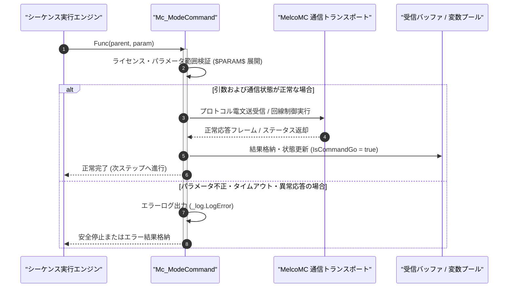

# コマンドリファレンス：Mc_Mode

## 概要

**Mc_Mode** は、MELSEC MC プロトコル（3E フレーム）における交信経路情報（ネットワーク番号、PC 番号）および電文形式（ **バイナリ形式** または **ASCII 形式** ）を動的に設定・切り替えるコマンドです。

---

## 💡 書式・パラメータ仕様

### コマンド構文

```csv
,SEQUENCE, [ステップキー], Mc_Mode, "[NetworkNo: 0]", "[PcNo: 255]", "[Format: Binary]"
```

### パラメータ（引数）一覧

| 引数位置 | 引数名 | 必須/任意 | 説明・制約 |
| :--- | :--- | :---: | :--- |
| 第 1 引数 | `NetworkNo` | 任意 | 宛先ネットワーク番号（`0`〜`255`、省略時既定値: `"0"`＝自局ネットワーク）。 |
| 第 2 引数 | `PcNo` | 任意 | 宛先 PC 番号（`0`〜`255`、省略時既定値: `"255"`［`0xFF`：自局アクセス］）。 |
| 第 3 引数 | `Format` | 任意 | 3E フレームの表現形式（`"Binary"` または `"ASCII"`、省略時既定値: `"Binary"`）。 |

---

## 🔄 特殊置換規約・分岐規約の適用

本コマンドの引数における特殊記法および解釈ルールです。
* **動的置換（`$`）**: 引数内で `$PARAMキー$` のように記述すると、実行時に変数プール（PARAM）の値へ動的置換されます。（適用可能な引数: 全引数対応）
* **ジャンプ先指定（`#`）**: 本コマンドはジャンプ制御を行わないため適用されません。（適用可能な引数: 非適用）
* **共通コマンド指定（`@`）**: 本コマンドは外部マクロを呼び出さないため、共通コマンド呼び出し記法は適用されません。（適用可能な引数: 非適用）
* **カンマのエスケープ**: 通信条件文字列（例: `"9600,E,7,1"`）や複数データのカンマ区切り値を単一引数として渡す場合は、必ず `"..."` と二重引用符で囲んで記述します。
* **エイリアス（別名）**: `Analysis_Mc_Mode`, `Sqn_Mc_Mode`

---

## 💡 動作例（正しい構文での記述例）

### スクリプト記述例

※COMMAND ブロック配下の子要素行（PARAM, SEQUENCE）は必ず行頭カンマから開始し、スペースインデントや行末コメント（`;`）は記述しないでください。

```csv
COMMAND, "SAMPLE_MC_MODE", ""
; 1. 自局アクセス（Net:0, PC:255）・ASCII 形式へ切り替え
,SEQUENCE, 010, Mc_Mode, "0", "255", "ASCII"
,SEQUENCE, 020, Mc_Open, "192.168.1.10", "5000", "TCP"
; 2. ASCII 形式で D0 から 4 ワード読出
,SEQUENCE, 030, Mc_ReadWord, "D0", 4, "@RESULT_D0"
,SEQUENCE, 040, Mc_Close
,SEQUENCE, 050, Exit
```

### 実行時の挙動・変数変化

* **実行前の状態**: Term 通信エンジンが初期化され、必要な通信パラメータおよび変数プール（`PARAM`）が準備されている状態。
* **実行後の状態**: ステップ実行により `Mc_Mode` の通信制御・プロトコル処理が正常に遂行され、結果または回線状態が更新されます。

---

## 🔄 動作フロー（シーケンス図）



---

## 🚫 エラーハンドリング・安全設計（仕様制限）

入力データの異常や実行時エラーに対し、解析・実行エンジンが実行するセーフティ規約です。

1. **引数範囲・プロトコル書式バリデーション保護**:
   - 必須引数の欠落、デバイス表記・数値範囲の不正、または余剰引数が指定された場合は `_log.LogError` に詳細を記録し、`SetErrorAndHalt` により異常電文の送出を未然に遮断します。
2. **通信タイムアウト・異常応答・排他ドメイン保護**:
   - 相手機器の無応答タイムアウト、NAK／異常終了コード応答、または他通信ドメインとの排他競合が発生した場合は、例外クラッシュを起こさず安全にエラーハンドリングを行います。

---

## 🧪 ユニットテスト仕様

本コマンドクラス（`Mc_ModeCommand.cs`）に実装されている `RunUnitTest()` メソッドが検証するユニットテストの仕様です。

### テスト実行前提条件

* **実行トリガー**: `RunUnitTest()` メソッドの呼び出し
* **有効化条件**: システム全体の最小ログレベル（`ErrorLogger.MinimumLevel`）が `LogLevel.Test` であること（それ以外の場合は無効化ガードにより早期リターン）
* **検証結果出力**: `_log.LogTest` によるログ出力。検証失敗時は `_log.LogError`、予期せぬ例外発生時は `_log.LogCritical` で記録し、`finally` ブロックで `Mc3EFrameEngine.DefaultNetworkNo = 0` および `DefaultPcNo = 255` へ復元します。

### テストケース一覧

| No | テストカテゴリ | テスト条件（入力値） | 期待される結果（出力値） | 検証の目的 / 観点 |
| :---: | :--- | :--- | :--- | :--- |
| **1** | 正常系 | 引数 `"1"`, `"254"`, `"Binary"` を指定して実行 | `!param.HasError` かつ `param.IsCommandGo == true`、`DefaultNetworkNo == 1`、`DefaultPcNo == 254`、`FrameFormat == McFrameFormat.Binary` となる | ネットワーク番号・PC 番号・フレーム形式の動的変更検証 |
| **2** | 異常系 | 引数なしまたは 4 個以上の指定（`ValidateParamRange(1, 3)` 違反）、および設定処理中の例外発生 | 引数範囲外エラー出力による早期リターン、または `_log.LogCritical` 記録と `SetErrorAndHalt(-1, ex.Message)` による安全停止 | 引数個数境界ガードおよびモード変更例外時のクラッシュ防御検証 |
