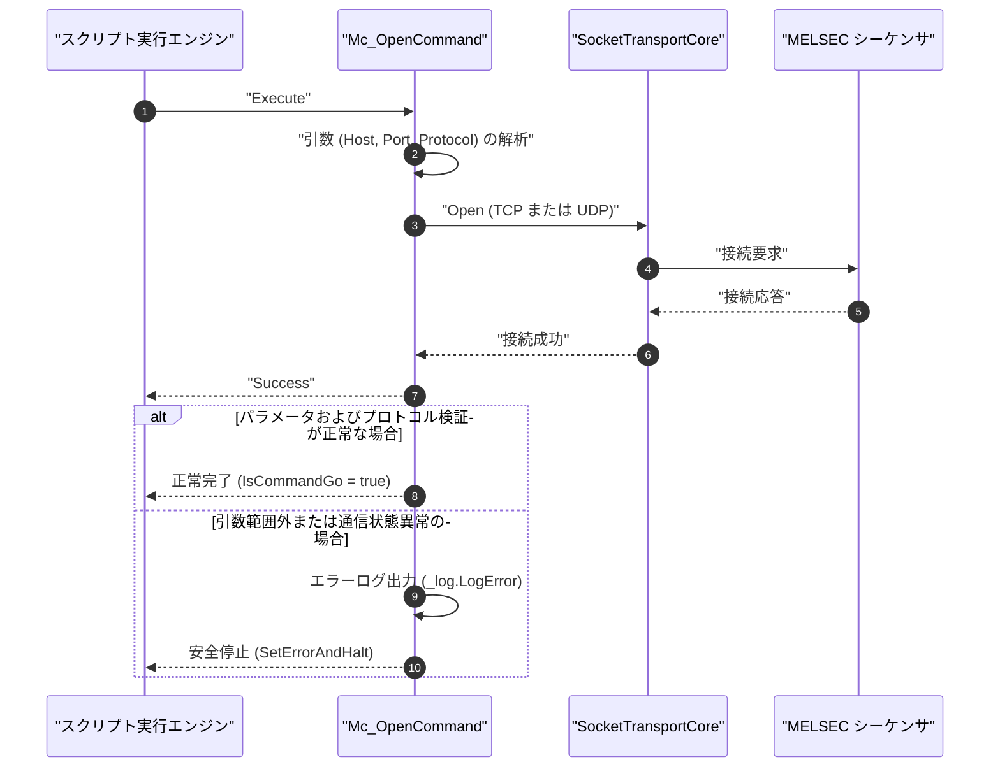

# コマンドリファレンス：Mc_Open

## 概要

**Mc_Open** は、設定値または引数で指定された接続先（IP アドレス / ホスト名、ポート番号、TCP / UDP プロトコル）に基づき、三菱電機 MELSEC MC プロトコル（3E フレーム）用の通信ソケットを開設するコマンドです。
実行時に Term 通信制御の排他選択モードを **MELSEC MC モード** （`TermAnalysis.MelcoMC.dll`）へ確定させます。

---

## 💡 書式・パラメータ仕様

### コマンド構文

```csv
,SEQUENCE, [ステップキー], Mc_Open, "[Host: 192.168.1.10]", "[Port: 5000]", "[Protocol: TCP]"
```

※ 引数を省略した場合は、UI プロパティ設定画面（または `Mc_Mode`）の現在の設定値が自動適用されます。

### パラメータ（引数）一覧

| 引数位置 | 引数名 | 必須/任意 | 説明・制約 |
| :--- | :--- | :---: | :--- |
| 第 1 引数 | `Host` | 任意 | 接続先 PLC の IP アドレスまたはホスト名（`"192.168.1.10:5000"` 形式も可、省略時既定値: `"192.168.1.10"`）。 |
| 第 2 引数 | `Port` | 任意 | 接続先ポート番号文字列（省略時既定値: `"5000"`）。 |
| 第 3 引数 | `Protocol` | 任意 | 通信トランスポート層プロトコル（`"TCP"` または `"UDP"`、省略時既定値: `"TCP"`）。 |

---

## 🔄 特殊置換規約・分岐規約の適用

本コマンドの引数における特殊記法および解釈ルールです。
* **動的置換（`$`）**: 引数内で `$PARAMキー$` のように記述すると、実行時に変数プール（PARAM）の値へ動的置換されます。（適用可能な引数: 全引数対応）
* **ジャンプ先指定（`#`）**: 本コマンドはジャンプ制御を行わないため適用されません。（適用可能な引数: 非適用）
* **共通コマンド指定（`@`）**: 本コマンドは外部マクロを呼び出さないため、共通コマンド呼び出し記法は適用されません。（適用可能な引数: 非適用）
* **カンマのエスケープ**: 通信条件文字列（例: `"9600,E,7,1"`）や複数データのカンマ区切り値を単一引数として渡す場合は、必ず `"..."` と二重引用符で囲んで記述します。
* **エイリアス（別名）**: `Analysis_Mc_Open`, `Sqn_Mc_Open`

---

## 💡 動作例（正しい構文での記述例）

### スクリプト記述例

※COMMAND ブロック配下の子要素行（PARAM, SEQUENCE）は必ず行頭カンマから開始し、スペースインデントや行末コメント（`;`）は記述しないでください。

```csv
COMMAND, "SAMPLE_MC_OPEN", ""
; 1. MELSEC MC プロトコル（IP: 192.168.1.10, Port: 5000, TCP）でオープン
,SEQUENCE, 010, Mc_Open, "192.168.1.10:5000", "TCP"
; 2. D100 から 2 ワード読出
,SEQUENCE, 020, Mc_ReadWord, "D100", 2, "@RCV_DATA"
; 3. ソケット切断
,SEQUENCE, 030, Mc_Close
,SEQUENCE, 040, Exit
```

### 実行時の挙動・変数変化

* **実行前の状態**: Term 通信エンジンが初期化され、必要な通信パラメータおよび変数プール（`PARAM`）が準備されている状態。
* **実行後の状態**: ステップ実行により `Mc_Open` の通信制御・プロトコル処理が正常に遂行され、結果または回線状態が更新されます。

---

## 🔄 動作フロー（シーケンス図）



---

## 🚫 エラーハンドリング・安全設計（仕様制限）

入力データの異常や実行時エラーに対し、解析・実行エンジンが実行するセーフティ規約です。

1. **引数範囲・プロトコル書式バリデーション保護**:
   - 必須引数の欠落、デバイス表記・数値範囲の不正、または余剰引数が指定された場合は `_log.LogError` に詳細を記録し、`SetErrorAndHalt` により異常電文の送出を未然に遮断します。
2. **通信タイムアウト・異常応答・排他ドメイン保護**:
   - 相手機器の無応答タイムアウト、NAK／異常終了コード応答、または他通信ドメインとの排他競合が発生した場合は、例外クラッシュを起こさず安全にエラーハンドリングを行います。

---

## 🧪 ユニットテスト仕様

本コマンドクラス（`Mc_OpenCommand.cs`）に実装されている `RunUnitTest()` メソッドが検証するユニットテストの仕様です。

### テスト実行前提条件

* **実行トリガー**: `RunUnitTest()` メソッドの呼び出し
* **有効化条件**: システム全体の最小ログレベル（`ErrorLogger.MinimumLevel`）が `LogLevel.Test` であること（それ以外の場合は無効化ガードにより早期リターン）
* **検証結果出力**: `_log.LogTest` によるログ出力。検証失敗時は `_log.LogError`、予期せぬ例外発生時は `_log.LogCritical` で記録し、`finally` ブロックで `SocketTransportCore.Shared.IsSimulationMode` を開始前の状態へ復元します。

### テストケース一覧

| No | テストカテゴリ | テスト条件（入力値） | 期待される結果（出力値） | 検証の目的 / 観点 |
| :---: | :--- | :--- | :--- | :--- |
| **1** | 正常系 | `SocketTransportCore.Shared.IsSimulationMode = true` 環境下で引数 `"127.0.0.1"`, `"5000"` を指定して実行 | `!param.HasError` かつ `param.IsCommandGo == true`、`Host == "127.0.0.1"`、`Port == 5000` となる | 接続先 IP アドレス・ポート番号の適用および MC ソケット接続確立の検証 |
| **2** | 異常系 | 引数 4 個以上の過剰指定（`ValidateParamRange(0, 3)` 違反）または実回線モードでのソケット接続失敗（`!connected`） | 引数検証エラーによる早期リターン、または `SetErrorAndHalt(-1, failMsg)` により安全に停止する | 引数境界チェックおよび PLC 未応答・接続拒否時のフェイルセーフ検証 |
