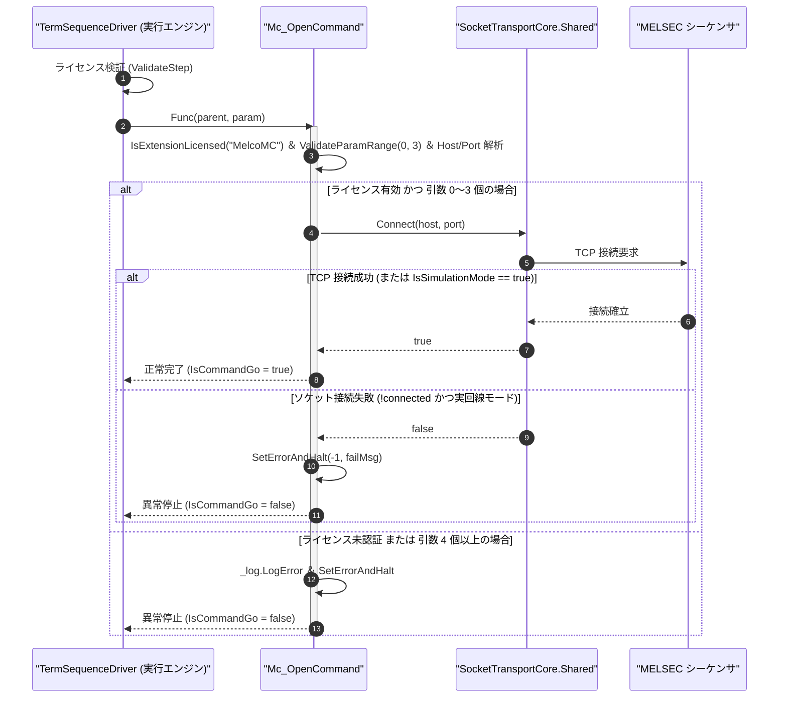

# コマンドリファレンス：Mc_Open

## 概要

**Mc_Open** は、設定値または引数で指定された接続先（IP アドレス / ホスト名、TCP ポート番号）に基づき、三菱電機 MELSEC MC プロトコル（ **TCP・バイナリ 3E フレーム専用** ）用の通信ソケットを開設する通信制御系コマンドです。
`SocketTransportCore.Shared.Connect` を介して接続を確立し、既存の TCP ソケット接続がある場合は安全にクローズした上で再接続を行います（UDP および ASCII 3E フレームは未実装です）。

---

## 💡 書式・パラメータ仕様

### コマンド構文

```csv
,SEQUENCE, [ステップキー], Mc_Open, "[Host: 192.168.1.10]", "[Port: 5000]", "[Protocol: TCP]"
```

※ 引数を省略した場合は、UI プロパティ設定画面の現在の設定値（未取得時は既定値 `"192.168.1.10"`, `5000`）およびネットワーク番号・PC 番号・CPU 監視タイマ換算値が自動適用されます。

### パラメータ（引数）一覧

| 引数位置 | 引数名 | 必須/任意 | 説明・制約 |
| :--- | :--- | :---: | :--- |
| 第 1 引数 | `Host` | 任意 | 接続先 PLC の IP アドレスまたはホスト名（`"192.168.1.10:5000"` のように `:Port` 付きの形式も可、省略時既定値: `"192.168.1.10"`）。 |
| 第 2 引数 | `Port` | 任意 | 接続先 TCP ポート番号の整数文字列（有効範囲 `1`〜`65535`、省略時既定値: `"5000"`）。範囲外や非数値文字列が渡された場合はエラー停止せず、直前の有効ポート値（UI 設定値、第 1 引数の `:Port`、または既定値 `5000`）へフォールバックします。 |
| 第 3 引数 | `Protocol` | 任意 | 互換用の予約引数（既定値: `"TCP"`）。`Func` 内では参照されず、実通信は常に **TCP（バイナリ 3E フレーム）固定** で接続されます。 |

---

## 🔄 特殊置換規約・分岐規約の適用

本コマンドの引数における特殊記法および解釈ルールです。
* **動的置換（`$`）**: 引数内で `$PARAMキー$` のように記述すると、実行時に変数プール（PARAM）の値へ動的置換されます。（適用可能な引数: 全引数対応）
* **ジャンプ先指定（`#`）**: 本コマンドはジャンプ制御を行わないため適用されません。（適用可能な引数: 非適用）
* **共通コマンド指定（`@`）**: 本コマンドは外部マクロを呼び出さないため、共通コマンド呼び出し記法は適用されません。（適用可能な引数: 非適用）
* **カンマのエスケープ**: 引数自体にカンマを含める場合は、必ず `"..."` と二重引用符で囲んで記述します。
* **エイリアス（別名）**: `Analysis_Mc_Open`, `Sqn_Mc_Open`

---

## 💡 動作例（正しい構文での記述例）

### スクリプト記述例

※COMMAND ブロック配下の子要素行（PARAM, SEQUENCE）は必ず行頭カンマから開始し、スペースインデントや行末コメント（`;`）は記述しないでください。

```csv
COMMAND, "SAMPLE_MC_OPEN", "RCV_DATA"
,PARAM, "RCV_DATA", Work, "D100読出結果", ""
; 1. MELSEC MC プロトコル（IP: 192.168.1.10, Port: 5000, TCP）でオープン
,SEQUENCE, 010, Mc_Open, "192.168.1.10", "5000", "TCP"
; 2. D100 から 1 ワード（DEC）読出し RCV_DATA へ格納
,SEQUENCE, 020, Mc_ReadWord, "D100", 1, "RCV_DATA", "DEC"
; 3. 読出値が閾値 100 以上か判定（不成立時は #NG_PROC# へ分岐）
,SEQUENCE, 030, Judge, "GE", "$RCV_DATA$", "100", "#NG_PROC#"
,SEQUENCE, 040, Mc_Close
,SEQUENCE, 050, Exit, "$RCV_DATA$", 0
; 条件不成立時のクローズ＆異常終了経路
,SEQUENCE, #NG_PROC#, Mc_Close
,SEQUENCE, 070, Exit, "NG", -1
```

### 実行時の挙動・変数変化

* **実行前の状態**: Term 通信エンジンが初期化され、変数プール（`PARAM`）に `"RCV_DATA"` が定義されている状態。
* **実行後の状態**: `Mc_Open` により `SocketTransportCore.Shared.Connect("192.168.1.10", 5000)` が実行されて TCP ソケット接続が確立され、続く `Mc_ReadWord` で読み出された値が `"RCV_DATA"` に格納されます。値が `100` 以上であればソケットを閉じて正常終了し、未満であれば `#NG_PROC#` へ分岐してクローズ後にエラー終了します。

---

## 🔄 動作フロー（シーケンス図）



---

## 🚫 エラーハンドリング・安全設計（仕様制限）

入力データの異常や実行時エラーに対し、解析・実行エンジンが実行するセーフティ規約です。

1. **ライセンス検証および引数範囲ガード**:
   - `MelcoMC` 拡張ライセンスが未認証の場合はエラーコード `-100` で即座に停止し、引数が 4 個以上指定された場合（`ValidateParamRange(0, 3)` 違反）も `_log.LogError` に記録して停止します。また、第 2 引数 `Port` が `1`〜`65535` 以外の文字列である場合は既定ポート（または UI 設定値）へ安全にフォールバックします。
2. **ソケット再接続制御と接続失敗時の安全停止**:
   - `SocketTransportCore.Shared.Connect` により既存 TCP ソケットがあれば安全にクローズしてから新規接続を確立します。実回線モードで接続に失敗した場合（`!connected`）は `SetErrorAndHalt(-1, failMsg)` で停止し、予期せぬ例外発生時は `_log.LogCritical` と `SetErrorAndHalt(-1, ex.Message)` でクラッシュを防ぎます。

---

## 🧪 ユニットテスト仕様

本コマンドクラス（`Mc_OpenCommand.cs`）に実装されている `RunUnitTest()` メソッドが検証するユニットテストの仕様です。

### テスト実行前提条件

* **実行トリガー**: `RunUnitTest()` メソッドの呼び出し
* **有効化条件**: システム全体の最小ログレベル（`ErrorLogger.MinimumLevel`）が `LogLevel.Test` であること（それ以外の場合は無効化ガードにより早期リターン）
* **検証結果出力**: `_log.LogTest` によるログ出力。検証失敗時は `_log.LogError`、予期せぬ例外発生時は `_log.LogCritical` で記録し、`finally` ブロックで `SocketTransportCore.Shared.IsSimulationMode` を開始前の状態へ復元します。

### テストケース一覧

| No | テストカテゴリ | テスト条件（入力値） | 期待される結果（出力値） | 検証の目的 / 観点 |
| :---: | :--- | :--- | :--- | :--- |
| **1** | 正常系 | `SocketTransportCore.Shared.IsSimulationMode = true` 環境下で引数 `"127.0.0.1"`, `"5000"` を指定して実行 | `!param.HasError` かつ `param.IsCommandGo == true`、`Host == "127.0.0.1"`、`Port == 5000` となる | 接続先 IP アドレス・ポート番号の適用および MC ソケット接続確立の検証 |
| **2** | 異常系 | 余剰引数 4 個（`"127.0.0.1"`, `"5000"`, `"3000"`, `"EXTRA_INVALID"`）を指定して実行 | `ValidateParamRange(0, 3)` により拒否され、`invalidParam.HasError == true` かつ `!invalidParam.IsCommandGo` となる | 引数上限超過時のバリデーション拒否検証 |
