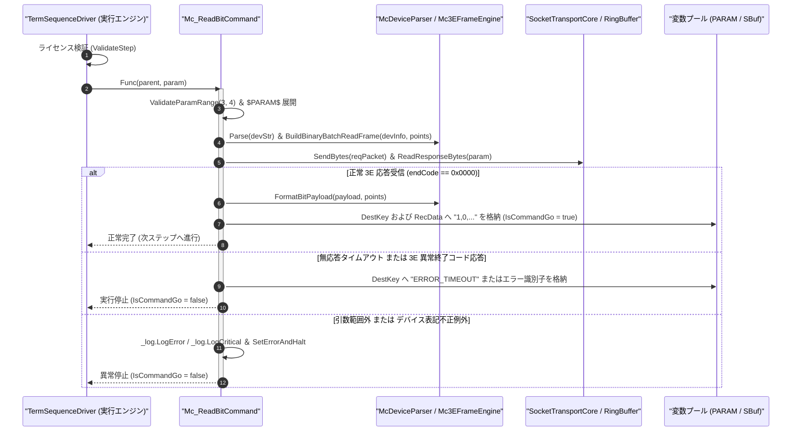

# コマンドリファレンス：Mc_ReadBit

## 概要

**Mc_ReadBit** は、MELSEC MC プロトコル（TCP・バイナリ 3E フレーム、コマンド `0401` サブコマンド `0001`）を用いて、シーケンサの **ビットデバイス（`M`, `X`, `Y`, `L`, `F`［アナンシエータ］, `V`［エッジリレー］, `B`, `TS`［タイマ接点］, `CS`［カウンタ接点］）を一括読出** する通信制御系コマンドです。
読み出された各ビット（ON=1 / OFF=0）は、カンマ区切りの文字列（例: `"1,0,1,1"`）として指定したパラメータへ自動格納されます。

---

## 💡 書式・パラメータ仕様

### コマンド構文

```csv
,SEQUENCE, [ステップキー], Mc_ReadBit, [Device], [Points], [DestKey], "[Reserved]"
```

### パラメータ（引数）一覧

| 引数位置 | 引数名 | 必須/任意 | 説明・制約 |
| :--- | :--- | :---: | :--- |
| 第 1 引数 | `Device` | **必須** | 読み出しを開始する先頭ビットデバイス名（対応デバイス: `M`［10進］, `X`［16進］, `Y`［16進］, `L`［10進］, `F`［10進］, `V`［10進］, `B`［16進］, `TS`［10進］, `CS`［10進］。例: `"M100"`, `"X0"`, `"Y20"`, `"B10"`）。 |
| 第 2 引数 | `Points` | **必須** | 読み出す連続ビット点数（正の整数文字列。`ushort.TryParse` 失敗時は `1` 点へフォールバックします。C# 側での上限遮断は行いませんが、MC プロトコル 3E バイナリ仕様上の推奨上限は `1`〜`7168` 点であり、PLC 仕様範囲外の点数を指定した場合は PLC 側から異常終了コードが返却されます）。 |
| 第 3 引数 | `DestKey` | **必須** | 取得したビット列（`"1,0,..."`）を保存する格納先パラメータキー名（`"@"` や `"$"` を付けない素のキー名、例: `"M100_BITS"`）。 |
| 第 4 引数 | `Reserved` | 任意 | 互換用の予備引数（`ValidateParamRange(3, 4)` により 4 引数まで許容されますが、指定された値は参照されず出力は常に `"1,0,..."` 形式となります）。 |

---

## 🔄 特殊置換規約・分岐規約の適用

本コマンドの引数における特殊記法および解釈ルールです。
* **動的置換（`$`）**: 引数内で `$PARAMキー$` のように記述すると、実行時に変数プール（PARAM）の値へ動的置換されます。（適用可能な引数: 全引数対応）
* **ジャンプ先指定（`#`）**: 本コマンドはジャンプ制御を行わないため適用されません。（適用可能な引数: 非適用）
* **共通コマンド指定（`@`）**: 本コマンドは外部マクロを呼び出さないため、共通コマンド呼び出し記法は適用されません。（適用可能な引数: 非適用）
* **カンマのエスケープ**: 引数自体にカンマを含める場合は、必ず `"..."` と二重引用符で囲んで記述します。
* **エイリアス（別名）**: `Mc_Read_Bit`, `Analysis_Mc_ReadBit`

---

## 💡 動作例（正しい構文での記述例）

### スクリプト記述例

※COMMAND ブロック配下の子要素行（PARAM, SEQUENCE）は必ず行頭カンマから開始し、スペースインデントや行末コメント（`;`）は記述しないでください。

```csv
COMMAND, "SAMPLE_MC_READBIT", "M100_BITS"
,PARAM, "M100_BITS", Work, "M100ビット読出結果", ""
; 1. 接続開始
,SEQUENCE, 010, Mc_Open, "192.168.1.10", "5000", "TCP"
; 2. M100 から 4 ビット（M100〜M103）を一括読出し M100_BITS へ格納
,SEQUENCE, 020, Mc_ReadBit, "M100", 4, "M100_BITS"
; 3. 全ビット OFF ("0,0,0,0") でないか判定（全 OFF 時は #NG_PROC# へ分岐）
,SEQUENCE, 030, Judge, "NEQ", "$M100_BITS$", "0,0,0,0", "#NG_PROC#"
,SEQUENCE, 040, Mc_Close
,SEQUENCE, 050, Exit, "$M100_BITS$", 0
; 条件不成立時のクローズ＆異常終了経路
,SEQUENCE, #NG_PROC#, Mc_Close
,SEQUENCE, 070, Exit, "NG", -1
```

### 実行時の挙動・変数変化

* **実行前の状態**: Term 通信エンジンが初期化され、変数プール（`PARAM`）に `"M100_BITS"` が定義されている状態。
* **実行後の状態**: ステップ `020` で 3E ビット一括読出フレームが送受信され、抽出されたビット状態（例: `"1,0,1,1"`）が `"M100_BITS"` に格納されます。後続の `Judge` で全 OFF でないことが確認されると回線を閉じて正常終了し、全 OFF の場合は `#NG_PROC#` へ分岐してクローズ後にエラー終了します（※無応答や異常終了コード受信時は `"ERROR_TIMEOUT"` 等を格納してステップ `020` で即停止します）。

---

## 🔄 動作フロー（シーケンス図）



---

## 🚫 エラーハンドリング・安全設計（仕様制限）

入力データの異常や実行時エラーに対し、解析・実行エンジンが実行するセーフティ規約です。

1. **引数範囲およびデバイス構文の検証**:
   - 引数が 2 個以下または 5 個以上の場合は `ValidateParamRange(3, 4)` により `_log.LogError` と `SetErrorAndHalt` で遮断します。未対応デバイスや書式不正により `McDeviceParser.Parse` が例外を送出した場合は、`catch` 節で `_log.LogCritical` に記録し `SetErrorAndHalt(-1, ex.Message)` で安全停止します（また `Points` が非数値文字列の場合は `1` 点へフォールバックします）。
2. **無応答タイムアウトおよび 3E 異常終了コードの検出**:
   - 受信データが空の場合は `DestKey` に `"ERROR_TIMEOUT"` を、フレーム長不足・サブヘッダ不一致・PLC 異常終了コード（非 `0x0000`）の場合は `"ERROR_LENGTH"` / `"ERROR_HEADER"` / `"ERROR_INCOMPLETE"` / `"ERROR_MC_XXXX"` を格納し、`param.IsCommandGo = false` として後続ステップへの誤進行を防止します。

---

## 🧪 ユニットテスト仕様

本コマンドクラス（`Mc_ReadBitCommand.cs`）に実装されている `RunUnitTest()` メソッドが検証するユニットテストの仕様です。

### テスト実行前提条件

* **実行トリガー**: `RunUnitTest()` メソッドの呼び出し
* **有効化条件**: システム全体の最小ログレベル（`ErrorLogger.MinimumLevel`）が `LogLevel.Test` であること（それ以外の場合は無効化ガードにより早期リターン）
* **検証結果出力**: `_log.LogTest` によるログ出力。検証失敗時は `_log.LogError`、予期せぬ例外発生時は `_log.LogCritical` で記録し、`finally` ブロックで `SocketTransportCore.Shared.IsSimulationMode` を開始前の状態へ復元します。

### テストケース一覧

| No | テストカテゴリ | テスト条件（入力値） | 期待される結果（出力値） | 検証の目的 / 観点 |
| :---: | :--- | :--- | :--- | :--- |
| **1** | 正常系 | `IsSimulationMode = true` 環境下で引数 `"M100"`, `"3"`, `"DEST_BIT"` および擬似 3E 応答（`D0 00 00 FF FF 03 00 04 00 00 00 10 01`）を与えて実行 | `!param.HasError` かつ `param.IsCommandGo == true`、格納先 `SBuf["DEST_BIT"]` が `"1,0,0"` と一致する | 3E ビット一括読出フレーム構築・ニブル展開解析・カンマ区切り格納の検証 |
| **2** | 異常系 | 引数 0 個（`new TermSequence { Name = "Mc_ReadBit" }`）で `Func(null, invalidParam)` を実行 | `ValidateParamRange(3, 4)` により拒否され、`invalidParam.HasError == true` かつ `!invalidParam.IsCommandGo` となる | 必須引数欠落時のバリデーション拒否検証 |
