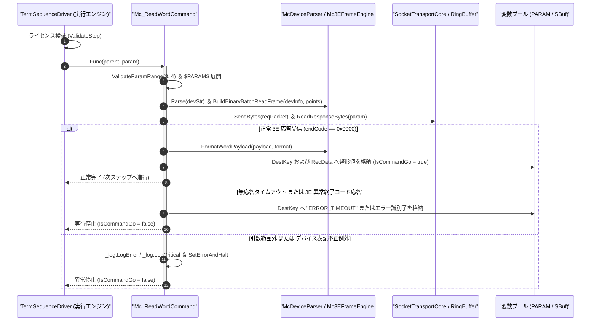

# コマンドリファレンス：Mc_ReadWord

## 概要

**Mc_ReadWord** は、MELSEC MC プロトコル（TCP・バイナリ 3E フレーム、コマンド `0401` サブコマンド `0000`）を用いて、シーケンサの **ワードデバイス（`D`, `W`, `R`, `ZR`, `TN`［タイマ現在値］, `CN`［カウンタ現在値］）を一括読出** する通信制御系コマンドです。
読み出された各ワード値（16 ビット）は、第 4 引数 `Format` の指定に従い、10 進数文字列（既定値 `"DEC"`、例: `"100,200"`）または 16 進数文字列（`"HEX"` 指定時、例: `"0064,00C8"`）のカンマ区切り形式で指定したパラメータへ自動格納されます。

---

## 💡 書式・パラメータ仕様

### コマンド構文

```csv
,SEQUENCE, [ステップキー], Mc_ReadWord, [Device], [Points], [DestKey], "[Format: DEC]"
```

### パラメータ（引数）一覧

| 引数位置 | 引数名 | 必須/任意 | 説明・制約 |
| :--- | :--- | :---: | :--- |
| 第 1 引数 | `Device` | **必須** | 読み出しを開始する先頭ワードデバイス名（対応デバイス: `D`［10進］, `W`［16進］, `R`［10進］, `ZR`［16進］, `TN`［10進］, `CN`［10進］。例: `"D100"`, `"W0"`, `"R10"`, `"ZR1000"`, `"TN0"`, `"CN0"`）。 |
| 第 2 引数 | `Points` | **必須** | 読み出す連続ワード点数（正の整数文字列。`ushort.TryParse` 失敗時は `1` 点へフォールバックします。C# 側での上限遮断は行いませんが、MC プロトコル 3E バイナリ仕様上の推奨上限は `1`〜`960` 点であり、PLC 仕様範囲外の点数を指定した場合は PLC 側から異常終了コードが返却されます）。 |
| 第 3 引数 | `DestKey` | **必須** | 取得したデータを保存する格納先パラメータキー名（`"@"` や `"$"` を付けない素のキー名、例: `"D100_VAL"`）。 |
| 第 4 引数 | `Format` | 任意 | 出力数値フォーマット（`"DEC"`: 符号付き 16 ビット 10 進数カンマ区切り、`"DEC"` 以外［`"HEX"` 等］: 4 桁大文字 16 進数カンマ区切り、省略時既定値: `"DEC"`）。 |

---

## 🔄 特殊置換規約・分岐規約の適用

本コマンドの引数における特殊記法および解釈ルールです。
* **動的置換（`$`）**: 引数内で `$PARAMキー$` のように記述すると、実行時に変数プール（PARAM）の値へ動的置換されます。（適用可能な引数: 全引数対応）
* **ジャンプ先指定（`#`）**: 本コマンドはジャンプ制御を行わないため適用されません。（適用可能な引数: 非適用）
* **共通コマンド指定（`@`）**: 本コマンドは外部マクロを呼び出さないため、共通コマンド呼び出し記法は適用されません。（適用可能な引数: 非適用）
* **カンマのエスケープ**: 引数自体にカンマを含める場合は、必ず `"..."` と二重引用符で囲んで記述します。
* **エイリアス（別名）**: `Mc_Read_Word`, `Analysis_Mc_ReadWord`

---

## 💡 動作例（正しい構文での記述例）

### スクリプト記述例

※COMMAND ブロック配下の子要素行（PARAM, SEQUENCE）は必ず行頭カンマから開始し、スペースインデントや行末コメント（`;`）は記述しないでください。

```csv
COMMAND, "SAMPLE_MC_READWORD", "D100_VAL"
,PARAM, "D100_VAL", Work, "D100読出値(DEC)", ""
,PARAM, "D200_HEX", Work, "D200読出値(HEX)", ""
; 1. 接続開始
,SEQUENCE, 010, Mc_Open, "192.168.1.10", "5000", "TCP"
; 2. D100 から 1 ワードを既定の 10 進形式（DEC）で読出
,SEQUENCE, 020, Mc_ReadWord, "D100", 1, "D100_VAL"
; 3. D200 から 2 ワードを 16 進形式（HEX）で一括読出
,SEQUENCE, 030, Mc_ReadWord, "D200", 2, "D200_HEX", "HEX"
; 4. D100 の読出値が閾値 100 以上か判定（未満時は #NG_PROC# へ分岐）
,SEQUENCE, 040, Judge, "GE", "$D100_VAL$", "100", "#NG_PROC#"
,SEQUENCE, 050, Mc_Close
,SEQUENCE, 060, Exit, "$D100_VAL$", 0
; 条件不成立時のクローズ＆異常終了経路
,SEQUENCE, #NG_PROC#, Mc_Close
,SEQUENCE, 080, Exit, "NG", -1
```

### 実行時の挙動・変数変化

* **実行前の状態**: Term 通信エンジンが初期化され、変数プール（`PARAM`）に `"D100_VAL"` と `"D200_HEX"` が定義されている状態。
* **実行後の状態**: ステップ `020` では `Format` 省略により既定値 `"DEC"` が適用されて `"D100_VAL"` に 10 進文字列（例: `"150"`）が格納され、ステップ `030` では `"HEX"` 指定により `"D200_HEX"` に 4 桁 16 進カンマ区切り文字列（例: `"1234,ABCD"`）が格納されます。`D100_VAL` が `100` 以上であれば回線を閉じて正常終了し、未満時は `#NG_PROC#` へ分岐してクローズ後にエラー終了します。

---

## 🔄 動作フロー（シーケンス図）



---

## 🚫 エラーハンドリング・安全設計（仕様制限）

入力データの異常や実行時エラーに対し、解析・実行エンジンが実行するセーフティ規約です。

1. **引数範囲およびデバイス構文の検証**:
   - 引数が 2 個以下または 5 個以上の場合は `ValidateParamRange(3, 4)` により `_log.LogError` と `SetErrorAndHalt` で遮断します。未対応デバイスや書式不正により `McDeviceParser.Parse` が例外を送出した場合は、`catch` 節で `_log.LogCritical` に記録し `SetErrorAndHalt(-1, ex.Message)` で安全停止します（また `Points` が非数値文字列の場合は `1` 点へフォールバックします）。
2. **無応答タイムアウトおよび 3E 異常終了コードの検出**:
   - 受信データが空の場合は `DestKey` に `"ERROR_TIMEOUT"` を、フレーム長不足・サブヘッダ不一致・PLC 異常終了コード（非 `0x0000`）の場合は `"ERROR_LENGTH"` / `"ERROR_HEADER"` / `"ERROR_INCOMPLETE"` / `"ERROR_MC_XXXX"` を格納し、`param.IsCommandGo = false` として後続ステップへの誤進行を防止します。

---

## 🧪 ユニットテスト仕様

本コマンドクラス（`Mc_ReadWordCommand.cs`）に実装されている `RunUnitTest()` メソッドが検証するユニットテストの仕様です。

### テスト実行前提条件

* **実行トリガー**: `RunUnitTest()` メソッドの呼び出し
* **有効化条件**: システム全体の最小ログレベル（`ErrorLogger.MinimumLevel`）が `LogLevel.Test` であること（それ以外の場合は無効化ガードにより早期リターン）
* **検証結果出力**: `_log.LogTest` によるログ出力。検証失敗時は `_log.LogError`、予期せぬ例外発生時は `_log.LogCritical` で記録し、`finally` ブロックで `SocketTransportCore.Shared.IsSimulationMode` を開始前の状態へ復元します。

### テストケース一覧

| No | テストカテゴリ | テスト条件（入力値） | 期待される結果（出力値） | 検証の目的 / 観点 |
| :---: | :--- | :--- | :--- | :--- |
| **1** | 正常系 | `IsSimulationMode = true` 環境下で引数 `"D100"`, `"2"`, `"DEST_VAL"`, `"DEC"` および擬似 3E 応答（`D0 00 00 FF FF 03 00 06 00 00 00 64 00 C8 00`）を与えて実行 | `!param.HasError` かつ `param.IsCommandGo == true`、格納先 `SBuf["DEST_VAL"]` が `"100,200"` と一致する | 3E ワード一括読出フレーム構築・リトルエンディアン応答解析・DEC 文字列格納の検証 |
| **2** | 異常系 | 引数 0 個（`new TermSequence { Name = "Mc_ReadWord" }`）で `Func(null, invalidParam)` を実行 | `ValidateParamRange(3, 4)` により拒否され、`invalidParam.HasError == true` かつ `!invalidParam.IsCommandGo` となる | 必須引数欠落時のバリデーション拒否検証 |
