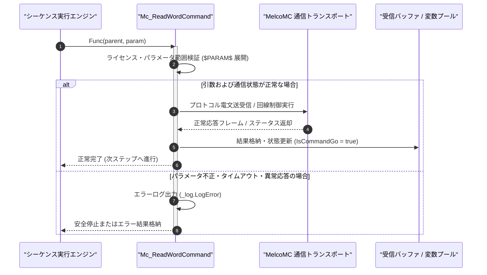

# コマンドリファレンス：Mc_ReadWord

## 概要

**Mc_ReadWord** は、MELSEC MC プロトコル（3E フレーム、コマンド `0401` サブコマンド `0000`）を用いて、シーケンサの **ワードデバイス（D, W, R, ZR 等）を一括読出** するコマンドです。
読み出された各ワード値（16 ビット）は、第 4 引数 `Format` の指定に従い、10 進数文字列（既定値 `"DEC"`、例: `"100,200"`）または 16 進数文字列（`"HEX"` 指定時、例: `"0064,00C8"`）のカンマ区切り形式で指定した結果変数／セルへ自動格納されます。

---

## 💡 書式・パラメータ仕様

### コマンド構文

```csv
,SEQUENCE, [ステップキー], Mc_ReadWord, [Device], [Points], [DestKey], "[Format: DEC]"
```

### パラメータ（引数）一覧

| 引数位置 | 引数名 | 必須/任意 | 説明・制約 |
| :--- | :--- | :---: | :--- |
| 第 1 引数 | `Device` | **必須** | 読み出しを開始する先頭ワードデバイス名（例: `"D100"`, `"W0"`, `"R10"`, `"ZR1000"`）。 |
| 第 2 引数 | `Points` | **必須** | 読み出す連続ワード点数（`1`〜`960` の正の整数）。 |
| 第 3 引数 | `DestKey` | **必須** | 取得したデータを保存する格納先変数キー名またはセル指定。 |
| 第 4 引数 | `Format` | 任意 | 出力数値フォーマット（`"DEC"`: 10 進数カンマ区切り、`"HEX"`: 16 進数表記、省略時既定値: `"DEC"`）。 |

---

## 🔄 特殊置換規約・分岐規約の適用

本コマンドの引数における特殊記法および解釈ルールです。
* **動的置換（`$`）**: 引数内で `$PARAMキー$` のように記述すると、実行時に変数プール（PARAM）の値へ動的置換されます。（適用可能な引数: 全引数対応）
* **ジャンプ先指定（`#`）**: 本コマンドはジャンプ制御を行わないため適用されません。（適用可能な引数: 非適用）
* **共通コマンド指定（`@`）**: 本コマンドは外部マクロを呼び出さないため、共通コマンド呼び出し記法は適用されません。（適用可能な引数: 非適用）
* **カンマのエスケープ**: 通信条件文字列（例: `"9600,E,7,1"`）や複数データのカンマ区切り値を単一引数として渡す場合は、必ず `"..."` と二重引用符で囲んで記述します。
* **エイリアス（別名）**: `Mc_Read_Word`, `Analysis_Mc_ReadWord`

---

## 💡 動作例（正しい構文での記述例）

### スクリプト記述例

※COMMAND ブロック配下の子要素行（PARAM, SEQUENCE）は必ず行頭カンマから開始し、スペースインデントや行末コメント（`;`）は記述しないでください。

```csv
COMMAND, "SAMPLE_MC_READWORD", ""
; 1. 接続開始
,SEQUENCE, 010, Mc_Open, "192.168.1.10", "5000", "TCP"
; 2. D100 から 2 ワード（D100, D101）を既定の 10 進形式（DEC）で一括読出
,SEQUENCE, 020, Mc_ReadWord, "D100", 2, "@D100_VAL"
; 3. D200 から 2 ワードを 16 進形式（HEX）で一括読出
,SEQUENCE, 030, Mc_ReadWord, "D200", 2, "@D200_HEX", "HEX"
; 4. 切断
,SEQUENCE, 040, Mc_Close
,SEQUENCE, 050, Exit
```

### 実行時の挙動・変数変化

* **実行前の状態**: Term 通信エンジンが初期化され、必要な通信パラメータおよび変数プール（`PARAM`）が準備されている状態。
* **実行後の状態**: ステップ `020` では `Format` 省略により既定値 `"DEC"` が適用され、`@D100_VAL` に `"100,200"` のような 10 進カンマ区切り文字列が格納されます。ステップ `030` では `"HEX"` 指定により、`@D200_HEX` に 16 進表記のカンマ区切り文字列（例: `"1234,ABCD"`）が格納されます。

---

## 🔄 動作フロー（シーケンス図）



---

## 🚫 エラーハンドリング・安全設計（仕様制限）

入力データの異常や実行時エラーに対し、解析・実行エンジンが実行するセーフティ規約です。

1. **引数範囲・プロトコル書式バリデーション保護**:
   - 必須引数の欠落、デバイス表記・数値範囲の不正、または余剰引数が指定された場合は `_log.LogError` に詳細を記録し、`SetErrorAndHalt` により異常電文の送出を未然に遮断します。
2. **通信タイムアウト・異常応答・排他ドメイン保護**:
   - 相手機器の無応答タイムアウト、NAK／異常終了コード応答、または他通信ドメインとの排他競合が発生した場合は、例外クラッシュを起こさず安全にエラーハンドリングを行います。

---

## 🧪 ユニットテスト仕様

本コマンドクラス（`Mc_ReadWordCommand.cs`）に実装されている `RunUnitTest()` メソッドが検証するユニットテストの仕様です。

### テスト実行前提条件

* **実行トリガー**: `RunUnitTest()` メソッドの呼び出し
* **有効化条件**: システム全体の最小ログレベル（`ErrorLogger.MinimumLevel`）が `LogLevel.Test` であること（それ以外の場合は無効化ガードにより早期リターン）
* **検証結果出力**: `_log.LogTest` によるログ出力。検証失敗時は `_log.LogError`、予期せぬ例外発生時は `_log.LogCritical` で記録し、`finally` ブロックで `SocketTransportCore.Shared.IsSimulationMode` を開始前の状態へ復元します。

### テストケース一覧

| No | テストカテゴリ | テスト条件（入力値） | 期待される結果（出力値） | 検証の目的 / 観点 |
| :---: | :--- | :--- | :--- | :--- |
| **1** | 正常系 | `IsSimulationMode = true` 環境下で引数 `"D100"`, `"2"`, `"DEST_VAL"`, `"DEC"` および擬似 3E 応答（`D0 00 00 FF FF 03 00 06 00 00 00 64 00 C8 00`）を与えて実行 | `!param.HasError` かつ `param.IsCommandGo == true`、格納先 `SBuf["DEST_VAL"]` が `"100,200"` と一致する | 3E ワード一括読出フレーム構築・リトルエンディアン応答解析・DEC 文字列格納の検証 |
| **2** | 異常系 | 引数不足・過剰（`ValidateParamRange(3, 4)` 違反）、空応答受信、または 3E 異常終了コード応答 | 空応答時は `DestKey` に `"ERROR_TIMEOUT"`、異常終了コード時はエラー文字列を格納して `IsCommandGo = false` で安全停止する | 引数境界検証および無応答・PLC 異常終了コード時のフェイルセーフ検証 |
