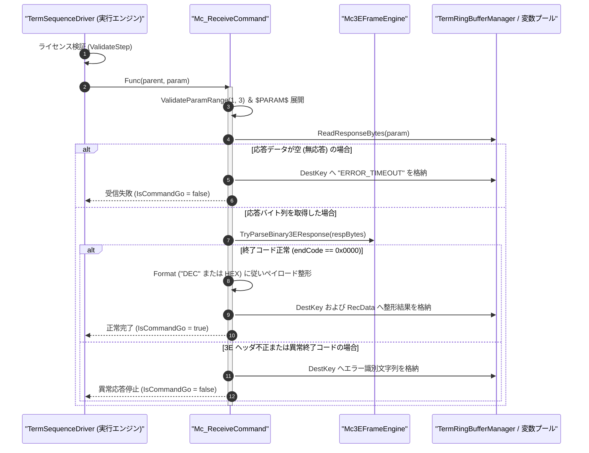

# コマンドリファレンス：Mc_Receive

## 概要

**Mc_Receive** は、`Mc_Send` 等により送信された要求電文に対するシーケンサからの **MC プロトコル 3E バイナリ応答フレームを受信し、終了コードを検証して応答データ部を抽出** する汎用受信用コマンドです。
抽出したペイロードは、第 2 引数 `Format` の指定に従い 16 進ダンプ文字列（既定値 `"HEX"`）または 10 進ワード文字列（`"DEC"`）へ整形して `DestKey` に格納します。

---

## 💡 書式・パラメータ仕様

### コマンド構文

```csv
,SEQUENCE, [ステップキー], Mc_Receive, [DestKey], "[Format: HEX]", "[Reserved]"
```

### パラメータ（引数）一覧

| 引数位置 | 引数名 | 必須/任意 | 説明・制約 |
| :--- | :--- | :---: | :--- |
| 第 1 引数 | `DestKey` | **必須** | 抽出された応答データ部を格納するパラメータキー名（`"@"` や `"$"` を付けない素のキー名、例: `"RAW_RES"`）。 |
| 第 2 引数 | `Format` | 任意 | 格納データ形式（`"DEC"`: 16 ビットワード単位の符号付き 10 進カンマ区切り文字列、`"DEC"` 以外［`"HEX"` 等］: 連続 16 進ダンプ文字列、省略時既定値: `"HEX"`）。 |
| 第 3 引数 | `Reserved` | 任意 | 互換用の予備引数（`ValidateParamRange(1, 3)` により 3 引数まで許容されますが、指定された値は参照されません）。 |

---

## 🔄 特殊置換規約・分岐規約の適用

本コマンドの引数における特殊記法および解釈ルールです。
* **動的置換（`$`）**: 引数内で `$PARAMキー$` のように記述すると、実行時に変数プール（PARAM）の値へ動的置換されます。（適用可能な引数: 全引数対応）
* **ジャンプ先指定（`#`）**: 本コマンドはジャンプ制御を行わないため適用されません。（適用可能な引数: 非適用）
* **共通コマンド指定（`@`）**: 本コマンドは外部マクロを呼び出さないため、共通コマンド呼び出し記法は適用されません。（適用可能な引数: 非適用）
* **カンマのエスケープ**: 引数自体にカンマを含める場合は、必ず `"..."` と二重引用符で囲んで記述します。
* **エイリアス（別名）**: `Mc_R`, `Mc_Res_R`, `Analysis_Mc_Receive`

---

## 💡 動作例（正しい構文での記述例）

### スクリプト記述例

※COMMAND ブロック配下の子要素行（PARAM, SEQUENCE）は必ず行頭カンマから開始し、スペースインデントや行末コメント（`;`）は記述しないでください。

```csv
COMMAND, "SAMPLE_MC_RECEIVE", "RAW_RES"
,PARAM, "RAW_RES", Work, "3E応答ペイロード", ""
; 1. 接続開始
,SEQUENCE, 010, Mc_Open, "192.168.1.10", "5000", "TCP"
; 2. 3E 要求フレーム（D100 から 2 ワード読出）を直接送信
,SEQUENCE, 020, Mc_Send, "500000FFFF03000C00100001040000640000A80200"
; 3. 3E 応答フレームを受信し、ペイロードを HEX 形式（既定）で RAW_RES へ格納
,SEQUENCE, 030, Mc_Receive, "RAW_RES", "HEX"
; 4. 取得した HEX ペイロードが "00000000" でないか判定（全ゼロ時は #NG_PROC# へ分岐）
,SEQUENCE, 040, Judge, "NEQ", "$RAW_RES$", "00000000", "#NG_PROC#"
,SEQUENCE, 050, Mc_Close
,SEQUENCE, 060, Exit, "$RAW_RES$", 0
; 条件不成立時のクローズ＆異常終了経路
,SEQUENCE, #NG_PROC#, Mc_Close
,SEQUENCE, 080, Exit, "NG", -1
```

### 実行時の挙動・変数変化

* **実行前の状態**: `Mc_Send` により要求フレームが送出され、変数プール（`PARAM`）に `"RAW_RES"` が定義されており、受信リングバッファまたは `RecData` に 3E 応答フレームが到着している状態。
* **実行後の状態**: ステップ `030` で 3E サブヘッダ（`D0 00`）および終了コード（`0x0000`）が検証され、抽出されたデータペイロードが連続 16 進文字列（例: `"6400C800"`）として `"RAW_RES"` に格納されます。後続の `Judge` で非ゼロが確認されると回線を閉じて正常終了し、一致時は `#NG_PROC#` へ分岐してクローズ後にエラー終了します（※無応答や異常終了コード時はステップ `030` で即停止します）。

---

## 🔄 動作フロー（シーケンス図）



---

## 🚫 エラーハンドリング・安全設計（仕様制限）

入力データの異常や実行時エラーに対し、解析・実行エンジンが実行するセーフティ規約です。

1. **引数範囲検証および例外防御**:
   - 引数が 0 個または 4 個以上の場合は `ValidateParamRange(1, 3)` により `_log.LogError` と `SetErrorAndHalt` で停止します。また、`RecData` 内の 16 進変換失敗などの例外発生時は `catch` 節で `_log.LogCritical` に記録し、`SetErrorAndHalt(-1, ex.Message)` で安全停止します。
2. **無応答タイムアウトおよび 3E 異常終了コードの検出**:
   - 受信バッファが空の場合は `DestKey` に `"ERROR_TIMEOUT"` を、フレーム長不足・サブヘッダ不一致・PLC 異常終了コード（非 `0x0000`）の場合は `"ERROR_LENGTH"` / `"ERROR_HEADER"` / `"ERROR_INCOMPLETE"` / `"ERROR_MC_XXXX"` を格納し、`param.IsCommandGo = false` として後続ステップへの進行を停止します。

---

## 🧪 ユニットテスト仕様

本コマンドクラス（`Mc_ReceiveCommand.cs`）に実装されている `RunUnitTest()` メソッドが検証するユニットテストの仕様です。

### テスト実行前提条件

* **実行トリガー**: `RunUnitTest()` メソッドの呼び出し
* **有効化条件**: システム全体の最小ログレベル（`ErrorLogger.MinimumLevel`）が `LogLevel.Test` であること（それ以外の場合は無効化ガードにより早期リターン）
* **検証結果出力**: `_log.LogTest` によるログ出力。検証失敗時は `_log.LogError`、予期せぬ例外発生時は `_log.LogCritical` で記録し、`finally` ブロックで `SocketTransportCore.Shared.IsSimulationMode` を開始前の状態へ復元します。

### テストケース一覧

| No | テストカテゴリ | テスト条件（入力値） | 期待される結果（出力値） | 検証の目的 / 観点 |
| :---: | :--- | :--- | :--- | :--- |
| **1** | 正常系 | `IsSimulationMode = true` 環境下で引数 `"RCV_HEX"`, `"HEX"` および擬似 3E 応答（`D0 00 00 FF FF 03 00 04 00 00 00 BB AA`）を与えて実行 | `!param.HasError` かつ `param.IsCommandGo == true`、格納先 `SBuf["RCV_HEX"]` が `"BBAA"` と一致する | 3E 応答フレームの終了コード検証および HEX ペイロード抽出格納の検証 |
| **2** | 異常系 | 引数 0 個（`new TermSequence { Name = "Mc_Receive" }`）で `Func(null, invalidParam)` を実行 | `ValidateParamRange(1, 3)` により拒否され、`invalidParam.HasError == true` かつ `!invalidParam.IsCommandGo` となる | 必須引数 `DestKey` 欠落時のバリデーション拒否検証 |
