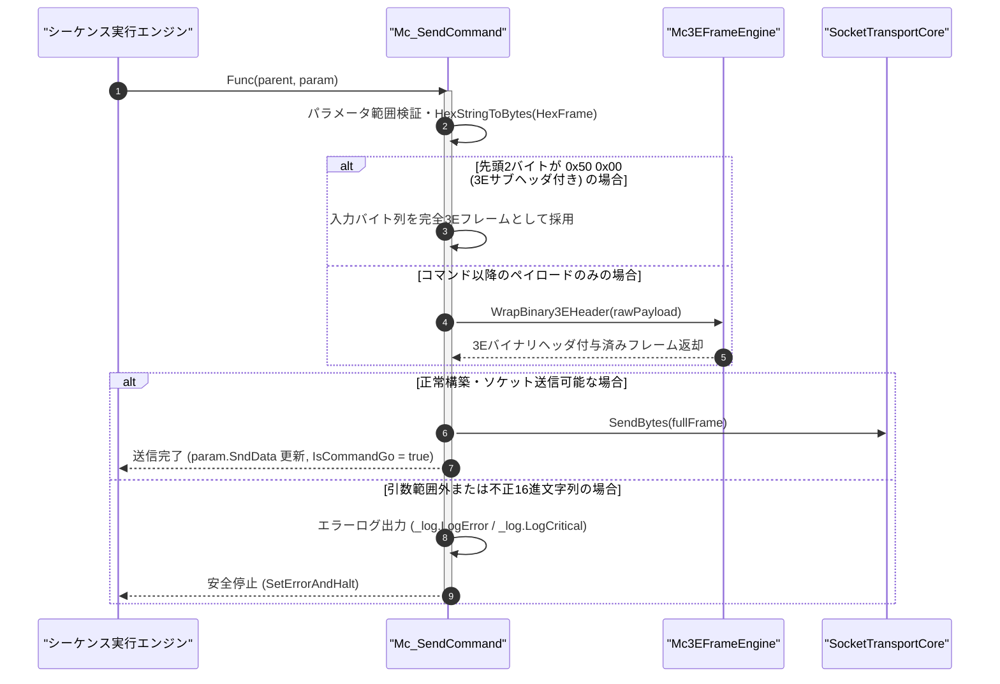

# コマンドリファレンス：Mc_Send

## 概要

**Mc_Send** は、MELSEC MC プロトコル（3E フレーム）の要求電文（16 進ダンプ文字列 `HexFrame`）をバイナリ変換してシーケンサ（PLC）へ直接送出する汎用送信用コマンドです。
第 1 引数 `HexFrame` の先頭 2 バイトが `50 00`（3E バイナリサブヘッダ）で始まる場合はそのまま完全フレームとして送出し、それ以外（コマンド・サブコマンド以降の要求データ部のみ）の場合は `Mc3EFrameEngine.WrapBinary3EHeader` により 3E ヘッダ（サブヘッダ・ネットワーク番号・PC 番号・要求データ長・CPU 監視タイマ）を自動付与して送信します。

---

## 💡 書式・パラメータ仕様

### コマンド構文

```csv
,SEQUENCE, [ステップキー], Mc_Send, [HexFrame]
```

### パラメータ（引数）一覧

| 引数位置 | 引数名 | 必須/任意 | 説明・制約 |
| :--- | :--- | :---: | :--- |
| 第 1 引数 | `HexFrame` | **必須** | 送信する 3E 要求フレーム全体またはコマンド以降の要求ペイロードを表す 16 進ダンプ文字列（例: `"500000FFFF03000600000001040000"` または `"01040000640000A80200"`）。先頭が `5000` でない場合は 3E バイナリヘッダを自動付与します。 |

---

## 🔄 特殊置換規約・分岐規約の適用

本コマンドの引数における特殊記法および解釈ルールです。
* **動的置換（`$`）**: 引数内で `$PARAMキー$` のように記述すると、実行時に変数プール（PARAM）の値へ動的置換されます。（適用可能な引数: 全引数対応）
* **ジャンプ先指定（`#`）**: 本コマンドはジャンプ制御を行わないため適用されません。（適用可能な引数: 非適用）
* **共通コマンド指定（`@`）**: 本コマンドは外部マクロを呼び出さないため、共通コマンド呼び出し記法は適用されません。（適用可能な引数: 非適用）
* **カンマのエスケープ**: 通信条件文字列（例: `"9600,E,7,1"`）や複数データのカンマ区切り値を単一引数として渡す場合は、必ず `"..."` と二重引用符で囲んで記述します。
* **エイリアス（別名）**: `Mc_S`, `Analysis_Mc_Send`

---

## 💡 動作例（正しい構文での記述例）

### スクリプト記述例

※COMMAND ブロック配下の子要素行（PARAM, SEQUENCE）は必ず行頭カンマから開始し、スペースインデントや行末コメント（`;`）は記述しないでください。

```csv
COMMAND, "SAMPLE_MC_SEND", ""
; 1. 接続開始
,SEQUENCE, 010, Mc_Open, "192.168.1.10", "5000", "TCP"
; 2. 3E バイナリ要求フレーム（D100 から 2 ワード読出要求）を 16 進ダンプ文字列で直接送信
,SEQUENCE, 020, Mc_Send, "500000FFFF03000C00100001040000640000A80200"
; 3. 応答フレームを受信し HEX 形式で変数へ格納
,SEQUENCE, 030, Mc_Receive, "@RAW_RES", "HEX"
; 4. 切断
,SEQUENCE, 040, Mc_Close
,SEQUENCE, 050, Exit
```

### 実行時の挙動・変数変化

* **実行前の状態**: PLC との MC ソケット回線がオープンされている状態。
* **実行後の状態**: ステップ `020` で第 1 引数の 16 進文字列がバイト配列へ変換（先頭 `50 00` 検出によりそのまま完全フレームとして採用）されて `param.SndData` に記録されるとともにソケットへ送出され、続く `Mc_Receive` で応答ペイロードが `@RAW_RES` に格納されます。

---

## 🔄 動作フロー（シーケンス図）



---

## 🚫 エラーハンドリング・安全設計（仕様制限）

入力データの異常や実行時エラーに対し、解析・実行エンジンが実行するセーフティ規約です。

1. **引数範囲・プロトコル書式バリデーション保護**:
   - 必須引数の欠落、デバイス表記・数値範囲の不正、または余剰引数が指定された場合は `_log.LogError` に詳細を記録し、`SetErrorAndHalt` により異常電文の送出を未然に遮断します。
2. **通信タイムアウト・異常応答・排他ドメイン保護**:
   - 相手機器の無応答タイムアウト、NAK／異常終了コード応答、または他通信ドメインとの排他競合が発生した場合は、例外クラッシュを起こさず安全にエラーハンドリングを行います。

---

## 🧪 ユニットテスト仕様

本コマンドクラス（`Mc_SendCommand.cs`）に実装されている `RunUnitTest()` メソッドが検証するユニットテストの仕様です。

### テスト実行前提条件

* **実行トリガー**: `RunUnitTest()` メソッドの呼び出し
* **有効化条件**: システム全体の最小ログレベル（`ErrorLogger.MinimumLevel`）が `LogLevel.Test` であること（それ以外の場合は無効化ガードにより早期リターン）
* **検証結果出力**: `_log.LogTest` によるログ出力。検証失敗時は `_log.LogError`、予期せぬ例外発生時は `_log.LogCritical` で記録し、`finally` ブロックで `SocketTransportCore.Shared.IsSimulationMode` を開始前の状態へ復元します。

### テストケース一覧

| No | テストカテゴリ | テスト条件（入力値） | 期待される結果（出力値） | 検証の目的 / 観点 |
| :---: | :--- | :--- | :--- | :--- |
| **1** | 正常系 | `IsSimulationMode = true` 環境下で第 1 引数 `HexFrame` に `"500000FFFF03000600000001040000"` を指定して実行 | `!param.HasError` かつ `param.IsCommandGo == true`、`param.SndData == "500000FFFF03000600000001040000"` となる | 3E 生 16 進フレームのバイナリ変換・サブヘッダ認識および送信データ確定の検証 |
| **2** | 異常系 | 必須引数 `HexFrame` 欠落・引数範囲外（`ValidateParamRange(1, 4)` 違反）、または不正な 16 進文字列による変換例外 | 引数検証エラーによる早期リターン、または `_log.LogCritical` 記録と `SetErrorAndHalt(-1, ex.Message)` による安全停止 | 引数境界チェックおよび不正 HEX 入力時のクラッシュ防御検証 |
