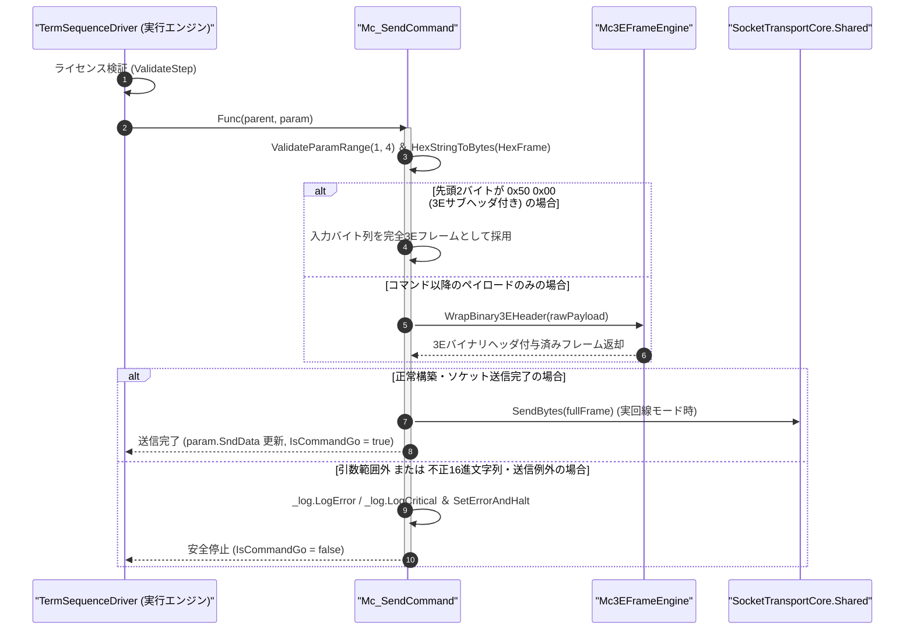

# コマンドリファレンス：Mc_Send

## 概要

**Mc_Send** は、MELSEC MC プロトコル（TCP・バイナリ 3E フレーム）の要求電文（16 進ダンプ文字列 `HexFrame`）をバイナリ変換してシーケンサ（PLC）へ直接送出する汎用送信用コマンドです。
第 1 引数 `HexFrame` の先頭 2 バイトが `50 00`（3E バイナリサブヘッダ）で始まる場合はそのまま完全フレームとして送出し、それ以外の場合は `Mc3EFrameEngine.WrapBinary3EHeader` により **先頭 9 バイトの 3E 共通要求ヘッダ** （サブヘッダ `50 00`［2B］＋ネットワーク番号［1B］＋PC 番号［1B］＋要求先ユニット I/O 番号 `FF 03`［2B］＋要求先ユニット局番号［1B］＋要求データ長［2B リトルエンディアン］）を自動付与して送信します。

> ⚠️ **注意（CPU 監視タイマの明示指定必須）**: 9 バイトヘッダ自動付与モードを使用する場合、 **CPU 監視タイマ（2 バイト、リトルエンディアン：例 `"1000"` ＝ `0x0010` ＝ 4000ms）は自動付与されません** 。必ず送信 HEX ペイロードの先頭に CPU 監視タイマ 2 バイトを含めて指定してください。

---

## 💡 書式・パラメータ仕様

### コマンド構文

```csv
,SEQUENCE, [ステップキー], Mc_Send, [HexFrame], "[Reserved2]", "[Reserved3]", "[Reserved4]"
```

### パラメータ（引数）一覧

| 引数位置 | 引数名 | 必須/任意 | 説明・制約 |
| :--- | :--- | :---: | :--- |
| 第 1 引数 | `HexFrame` | **必須** | 送信する 3E 要求フレーム全体、または **CPU 監視タイマ（2B）＋コマンド以降の要求ペイロード** を表す 16 進ダンプ文字列（例: 完全フレーム `"500000FFFF03000C00100001040000640000A80200"`、またはヘッダ自動付与 `"100001040000640000A80200"`）。先頭が `5000` でない場合は 9 バイトの 3E バイナリヘッダを自動付与します（奇数桁指定時は先頭 `"0"` 自動補完）。 |
| 第 2〜4 引数 | `Reserved2`〜`Reserved4` | 任意 | 互換用の予備引数（`ValidateParamRange(1, 4)` により最大 4 引数まで許容されますが、第 2〜第 4 引数の値は参照されません）。 |

---

## 🔄 特殊置換規約・分岐規約の適用

本コマンドの引数における特殊記法および解釈ルールです。
* **動的置換（`$`）**: 引数内で `$PARAMキー$` のように記述すると、実行時に変数プール（PARAM）の値へ動的置換されます。（適用可能な引数: 全引数対応）
* **ジャンプ先指定（`#`）**: 本コマンドはジャンプ制御を行わないため適用されません。（適用可能な引数: 非適用）
* **共通コマンド指定（`@`）**: 本コマンドは外部マクロを呼び出さないため、共通コマンド呼び出し記法は適用されません。（適用可能な引数: 非適用）
* **カンマのエスケープ**: 引数自体にカンマを含める場合は、必ず `"..."` と二重引用符で囲んで記述します。
* **エイリアス（別名）**: `Mc_S`, `Analysis_Mc_Send`

---

## 💡 動作例（正しい構文での記述例）

### スクリプト記述例

※COMMAND ブロック配下の子要素行（PARAM, SEQUENCE）は必ず行頭カンマから開始し、スペースインデントや行末コメント（`;`）は記述しないでください。

```csv
COMMAND, "SAMPLE_MC_SEND", "RAW_RES"
,PARAM, "RAW_RES", Work, "3E応答ペイロード", ""
; 1. 接続開始
,SEQUENCE, 010, Mc_Open, "192.168.1.10", "5000", "TCP"
; 2. CPU監視タイマ(1000)＋コマンド(0104)＋サブコマンド(0000)＋D100(640000A8)＋2点(0200) を指定（先頭9Bヘッダ自動付与）
,SEQUENCE, 020, Mc_Send, "100001040000640000A80200"
; 3. 応答フレームを受信し HEX 形式で RAW_RES へ格納
,SEQUENCE, 030, Mc_Receive, "RAW_RES", "HEX"
; 4. 取得ペイロードが "00000000" でないか判定（全ゼロ時は #NG_PROC# へ分岐）
,SEQUENCE, 040, Judge, "NEQ", "$RAW_RES$", "00000000", "#NG_PROC#"
,SEQUENCE, 050, Mc_Close
,SEQUENCE, 060, Exit, "$RAW_RES$", 0
; 条件不成立時のクローズ＆異常終了経路
,SEQUENCE, #NG_PROC#, Mc_Close
,SEQUENCE, 080, Exit, "NG", -1
```

### 実行時の挙動・変数変化

* **実行前の状態**: PLC との MC ソケット回線がオープンされ、変数プール（`PARAM`）に `"RAW_RES"` が定義されている状態。
* **実行後の状態**: ステップ `020` で第 1 引数の先頭が `50 00` でないため `WrapBinary3EHeader` により 9 バイトの 3E サブヘッダ＋経路＋データ長（`500000FFFF03000C00`）が自動付与され、完全フレーム `"500000FFFF03000C00100001040000640000A80200"` としてソケットへ送出されます。続く `Mc_Receive` で応答ペイロードが `"RAW_RES"` に格納され、`Judge` で判定後にソケットをクローズします。

---

## 🔄 動作フロー（シーケンス図）



---

## 🚫 エラーハンドリング・安全設計（仕様制限）

入力データの異常や実行時エラーに対し、解析・実行エンジンが実行するセーフティ規約です。

1. **引数範囲バリデーション保護**:
   - 必須引数 `HexFrame` が欠落している場合（0 個）または 5 個以上の引数が指定された場合は、`ValidateParamRange(1, 4)` により `_log.LogError` に詳細を記録し、`SetErrorAndHalt` で送信前に停止します。
2. **16 進文字列変換およびソケット送信例外の保護**:
   - 本コマンドは送信専用であり、不正な 16 進文字列による `HexStringToBytes` 変換例外や、ソケット未接続・切断時の `SendBytes` 送信例外が発生した場合は、`catch` 節で `_log.LogCritical` に記録し `SetErrorAndHalt(-1, ex.Message)` により安全に停止します。

---

## 🧪 ユニットテスト仕様

本コマンドクラス（`Mc_SendCommand.cs`）に実装されている `RunUnitTest()` メソッドが検証するユニットテストの仕様です。

### テスト実行前提条件

* **実行トリガー**: `RunUnitTest()` メソッドの呼び出し
* **有効化条件**: システム全体の最小ログレベル（`ErrorLogger.MinimumLevel`）が `LogLevel.Test` であること（それ以外の場合は無効化ガードにより早期リターン）
* **検証結果出力**: `_log.LogTest` によるログ出力。検証失敗時は `_log.LogError`、予期せぬ例外発生時は `_log.LogCritical` で記録し、`finally` ブロックで `SocketTransportCore.Shared.IsSimulationMode` を開始前の状態へ復元します。

### テストケース一覧

| No | テストカテゴリ | テスト条件（入力値） | 期待される結果（出力値） | 検証の目的 / 観点 |
| :---: | :--- | :--- | :--- | :--- |
| **1** | 正常系 | `IsSimulationMode = true` 環境下で第 1 引数 `HexFrame` に `"500000FFFF03000600000001040000"` を指定して実行 | `!param.HasError` かつ `param.IsCommandGo == true`、`param.SndData == "500000FFFF03000600000001040000"` となる | 3E 生 16 進フレームのバイナリ変換・サブヘッダ認識および送信データ確定の検証 |
| **2** | 異常系 | 引数 0 個（`new TermSequence { Name = "Mc_Send" }`）で `Func(null, invalidParam)` を実行 | `ValidateParamRange(1, 4)` により拒否され、`invalidParam.HasError == true` かつ `!invalidParam.IsCommandGo` となる | 必須引数 `HexFrame` 欠落時のバリデーション拒否検証 |
