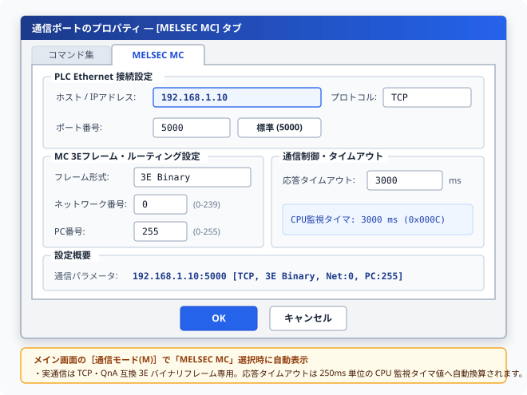
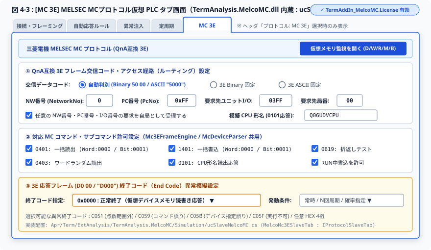

# MelcoMC（三菱電機 MELSEC MC プロトコル 3E）アドイン取扱説明書

👉 [← TermAddIn_MelcoMC 製品トップに戻る](../README.md)  
👉 [← プロパティ設定画面取扱説明書（共通）](../プロパティ設定画面取扱説明書.Md) ／ [← TermEmulator 操作説明書（共通）](https://github.com/Monaca-App/TermEmulator/blob/main/Manual/TermEmulator操作説明書.Md) ／ [← マクロスクリプト取扱説明書（共通）](../マクロスクリプト取扱説明書.Md)

---

本書は、**TermAddIn_MelcoMC**（`TermAnalysis.MelcoMC.dll`：三菱電機 MELSEC MC プロトコル QnA 互換 3E フレーム通信エクステンション）の **取扱説明書 兼 機能解説書** です。MC プロトコルの基礎仕組み、プロパティ設定画面の **「MELSEC MC」タブ**、**TermEmulator の `[MC 3E]` 仮想スレーブタブ**、および全 9 コマンドのリファレンスを 1 冊にまとめています。

* **必須拡張ライセンス**: **`TermAddIn_MelcoMC.License`** （組み込み先: `TermAnalysis.MelcoMC.dll`、`TermEmulator` と相互共用）


### 関連する公式規格・メーカー仕様書（外部リンク）
* [三菱電機 FA 公式サイト（マニュアル検索・ダウンロード）](https://www.mitsubishielectric.co.jp/fa/download/search.do?mode=manual) — サイト内のマニュアル検索より以下の公式マニュアルを参照できます（一部資料は無料の FA メンバーズ登録が必要）。
  * 『MELSEC コミュニケーションプロトコルリファレンスマニュアル』（マニュアル番号: `SH-080003`）［QnA 互換 3E フレーム・バイナリコマンド・終了コード仕様］
  * 各シリーズ（Q / L / iQ-R / iQ-F）の『Ethernet インタフェースユニット / CPU 内蔵 Ethernet ユーザーズマニュアル』
---

## 目次

- [1. 機能概要と基礎知識（はじめての方へ）](#1-機能概要と基礎知識はじめての方へ)
- [2. プロパティ設定画面：「MELSEC MC」タブの詳細](#2-プロパティ設定画面melsec-mcタブの詳細)
- [3. TermEmulator 仮想スレーブ設定：「[MC 3E]」タブの詳細](#3-termemulator-仮想スレーブ設定mc-3eタブの詳細)
- [4. マクロコマンド一覧（全 9 コマンド）](#4-マクロコマンド一覧全-9-コマンド)

---

## 1. 機能概要と基礎知識（はじめての方へ）

### 対応する機能の概要
**MelcoMC（三菱電機 MELSEC MC プロトコル 3E）** アドインは、三菱電機製の現行〜定番シーケンサ（Q / L / iQ-R / iQ-F シリーズ等）の Ethernet ポートと LAN ケーブルで接続し、**QnA 互換 3E バイナリフレーム（TCP）** によってワードデバイス（`ZR`, `D`, `W`, `R`, `TN`, `CN`）およびビットデバイス（`M`, `X`, `Y`, `B`, `L` 等）の一括読み書き、ならびに任意 3E 電文の送受信を行う高速通信機能です。

### 機能の実現方法
* **Pure C# による 3E バイナリフレーム自動構築**: サブヘッダ（`50 00`）、アクセス経路（ネットワーク番号・PC 番号・ユニット I/O `03FF`・局番）、CPU 監視タイマ（250 ms 単位自動換算）、およびコマンドコード（`0401` 読出 / `1401` 書込）をすべて内部で自動生成・解析します。
* **デバイス名指定だけの直感操作**: 利用者はバイト並び（リトルエンディアン）や 16 進デバイスコードを一切意識せず、`Mc_ReadWord, "D100", 10, "RESULT", "DEC"` のように書くだけで高速取得できます。
* **仮想 MC 3E サーバーによる安全検証**: `TermEmulator` の `[MC 3E]` タブで正常応答・終了コード異常（`C051`, `C05B` 等）を模擬でき、稼働中の生産設備へ繋ぐ前にロジックを完全検証できます。

### このアドインを選択することの利点
* **MX Component 等の有償ドライバ・ランタイム不要**: パソコン側への専用ソフトインストールやライセンス管理が不要で、LAN ケーブルを繋ぐだけで即座に Excel 連携を開始できます。
* **3E バイナリ形式による高速・省トラフィック通信**: ASCII 形式やシリアル計算機リンクと比べて電文長が短く通信速度が圧倒的に速いため、大量の `D` / `ZR` データの定期ロギングや高速検査ラインに適しています。
* **他の通信アドインと 1 シートで統合制御**: 同じ Excel シート上で「三菱 PLC（`MelcoMC`）で治具を動かし、計測器（`LxiRaw` / `Modbus`）で測定して合否判定する」一連の工程を一貫自動化できます。

### 「MC プロトコル 3E（バイナリ）」とは何か
* 三菱電機 PLC が標準で備えている LAN 通信の約束事が **「MC プロトコル」** です。
* その中でも現行機種で標準的に使われ、最も高速でデータ量が少ない形式が **「QnA 互換 3E フレーム（バイナリ形式・TCP 接続）」** です。本アドインはこの標準形式に特化しています。
* ※ シリアルケーブル（RS-232C）で繋ぐ旧型・計算機リンクユニットの場合は **[Melco（計算機リンク）](../Melco/Melco取扱説明書.Md)** を使用してください。

### 設定の妥当性を判断するためのチェックポイント
PLC 側の設計ソフト（GX Works2 / GX Works3 の「イーサネットポート設定」➔「オープン設定」）を見て、以下の 4 点を確認すれば正しく接続できます。

| 確認項目 | 項目の意味 | 設定値の目安・確認方法 |
| :--- | :--- | :--- |
| **ホスト / IP アドレス** | PLC の LAN ポートに割り当てられた住所 | GX Works の「自ノード IP アドレス」を確認します。パソコンの IP アドレスも **先頭 3 組の数字を同じ** に揃えてください。 |
| **ポート番号** | PLC 側で MC プロトコル用に開放したポート番号 | GX Works の「オープン設定」で **`プロトコル = TCP`**、**`オープン方式 = MCプロトコル`** として登録した **自局ポート番号**（例: `5000` や `5001`）と一致させます。 |
| **交信データコード（PLC 側）** | 電文をバイナリ（生データ）で送るか文字で送るか | 本アドインは **バイナリ形式専用** です。PLC 側のイーサネット設定も必ず **「バイナリコード交信」** になっていることを確認してください。 |
| **ネットワーク番号 / PC 番号** | 別のネットワークを経由して遠くの PLC へ行くための経路 | パソコンと PLC を直接（または同じハブ経由で）繋ぐ場合は、既定値の **`ネットワーク番号 = 0`、`PC 番号 = 255（0xFF：自局）`** のままで問題ありません。 |

### 通信の仕組み解説（3E バイナリフレーム構造と代表的なトラブル事例・対処法）
MC プロトコル 3E バイナリフレームは、先頭のサブヘッダと経路情報の後ろにコマンド本体を並べた固定構造で高速に通信します。

```text
要求 (PC ➔ PLC): [50 00] [NW] [PC=FF] [IO=FF 03] [局番=00] [データ長 2B] [監視タイマ 2B] [コマンド 0401/1401] [デバイス/点数]
応答 (PLC ➔ PC): [D0 00] [NW] [PC=FF] [IO=FF 03] [局番=00] [データ長 2B] [終了コード 0000=正常] [読出データ...]
```

* **事例①：TCP 接続自体が拒否される** ➔ PLC の「オープン設定」で MC プロトコル用の TCP ポート（例: `5000`）が登録されていない、または設定変更後に PLC の電源再投入（リセット）をしていないケースが頻発します。
* **事例②：接続はできるが応答が来ない／異常終了する** ➔ PLC 側の交信データコードが **「ASCII コード」** になっている可能性があります。本アドインは **バイナリ専用** のため、PLC 側を「バイナリコード」へ変更してください。
* **事例③：終了コード `C051` / `C05B` が返る** ➔ `C051` は一度に読む点数が上限超過、`C05B` は存在しないデバイス種別・番地を指定したことを意味します。

---

## 2. プロパティ設定画面：「MELSEC MC」タブの詳細



メイン画面で **`MELSEC MC`** モードを選択しているときに表示され、[`Mc_Open`](./Mc_Open.Md) 等の Ethernet MC プロトコル条件を設定します（`MELSEC_MC` セクションへ保存）。

| 項目名 | 設定値・範囲（既定値） | 詳しい意味と設定のポイント |
| :--- | :--- | :--- |
| **`ホスト / IP アドレス`** | IP アドレス（既定 `192.168.1.10`） | PLC の Ethernet ユニット IP アドレスを指定します（ローカルの TermEmulator 接続時は `127.0.0.1`）。 |
| **`ポート番号`** | `1`〜`65535`（既定 `5000`、`[ 標準 (5000) ]` ボタン付） | PLC 側で開放した MC プロトコル用 TCP ポート番号を指定します（実通信は TCP・QnA 互換 3E バイナリフレーム専用）。 |
| **`ネットワーク番号` / `PC 番号`** | ネットワーク `0`〜`239`（`0`）・PC 番号 `0`〜`255`（`255` ＝ `0xFF`） | 自局直結時は通常 `NW=0`、`PC=255` を指定します。 |
| **`タイムアウト`** | `100`〜`60000` ms（既定 `3000` ms） | 応答タイムアウト時間です（MC フレーム内の CPU 監視タイマ値へ 250 ms 単位で自動換算されます）。 |

### ローカルの TermEmulator（仮想 MELSEC MC 3E）へ接続する手順
1. メイン画面の上部メニュー **`[通信モード(M)] ➔ [MELSEC MC]`** を選択します。
2. **`[通信ポート(C)] ➔ [プロパティ(P)]`** を開き、自動表示された **「MELSEC MC」** タブをクリックします。
3. `ホスト / IP アドレス` に **`127.0.0.1`** 、`ポート番号` に **`5000`** （`[ 標準 (5000) ]` ボタンでも可）を入力し、 **`[OK]`** をクリックして保存します。

---

## 3. TermEmulator 仮想スレーブ設定：`[MC 3E]` タブの詳細

* **主な用途**: 三菱電機 Q / L / iQ-R / iQ-F シリーズ PLC の Ethernet 通信（QnA 互換 3E フレーム、TCP / UDP、標準ポート `5000` 等）の仮想 PLC 模擬。



| 設定区分 | 設定項目 | 設定値・範囲（既定値） | 詳しい動作と設定のポイント |
| :--- | :--- | :--- | :--- |
| **① 交信コード・経路** | **交信データコード** | `自動判別`（既定） / `3E Binary 固定` / `3E ASCII 固定` | バイナリ形式（要求サブヘッダ `50 00` ➔ 応答 `D0 00`）と ASCII 形式（`"5000"` ➔ `"D000"`）を自動判別または固定指定します。 |
| | **NW / PC / ユニット I/O / 局番** | NW `0`〜`239`（`0`）、PC `FF`、ユニット I/O `03FF`、局番 `00` | アクセス経路を厳密照合するか、 **`任意経路受理`** チェックを ON にしてどの経路指定でも応答するかを選べます。 |
| | **模擬 CPU 形名** | 文字列（既定 `Q06UDVCPU`） | CPU 形名読出コマンド（`0101`）を受信したときに返す形名文字列を設定します。 |
| **② 許可コマンド** | **対応コマンド許可** | `0401`（一括読出）、`1401`（一括書込）、`0403`（ランダム読出）、`0101`（CPU 形名読出）、`0619`（折返し）、`RUN 中書込許可` | ワード単位（サブコマンド `0000`）およびビット単位（`0001`）の読み書きに対応します。`RUN 中書込許可` を OFF にすると書込禁止エラーのテストが行えます。 |
| **③ 終了コード模擬** | **終了コード / 発動条件** | `0000`（正常） / `C051` / `C059` / `C05B` / `C05F` または任意 4 桁 HEX | `C051`（点数範囲外）、`C059`（コマンド誤り）、`C05B`（デバイス指定誤り）、`C05F`（実行不可）などの異常終了コードを常時・N 回周期・確率で返却できます。 |

---

## 4. マクロコマンド一覧（全 9 コマンド）

* **[Mc_Open](./Mc_Open.Md)** / **[Mc_Close](./Mc_Close.Md)**
  * **概要**: MELSEC Ethernet ポート（標準ポート `5000` 等）への **TCP ソケット接続（QnA 互換 3E バイナリフレーム専用）** を確立（`Mc_Open`）、および切断（`Mc_Close`）します（※UDP および ASCII 3E フレームは未実装です）。
  * **書式**:  
    `,SEQUENCE, [ステップキー], Mc_Open, "[ホストIP(またはHost:Port)]", "[ポート番号(既定5000)]"`  
    `,SEQUENCE, [ステップキー], Mc_Close`
* **[Mc_Mode](./Mc_Mode.Md)**
  * **概要**: MC プロトコル（QnA 互換 3E バイナリフレーム）の宛先ネットワーク番号および PC 番号等を設定します（最低 1 引数必須）。
  * **書式**: `,SEQUENCE, [ステップキー], Mc_Mode, "[NetworkNo]", "[PcNo]", "[Format(Binary)]"`
* **[Mc_ReadWord](./Mc_ReadWord.Md)** / **[Mc_WriteWord](./Mc_WriteWord.Md)**
  * **概要**: ワードデバイス（`ZR`, `D`, `W`, `R`, `TN`, `CN`）の一括読出（`0401`/`0000`）および一括書込（`1401`/`0000`）を実行します。
  * **書式**:  
    `,SEQUENCE, [ステップキー], Mc_ReadWord, "[Device]", [Points], "[DestKey]", "[Format(DEC/HEX)]"`  
    `,SEQUENCE, [ステップキー], Mc_WriteWord, "[Device]", "[Values(カンマ区切り可)]"`
* **[Mc_ReadBit](./Mc_ReadBit.Md)** / **[Mc_WriteBit](./Mc_WriteBit.Md)**
  * **概要**: ビットデバイス（`M`, `X`, `Y`, `B`, `L`, `F`, `V`, `TS`, `CS`）の一括読出（`0401`/`0001`）および一括書込（`1401`/`0001`、複数点時は `"1,0,1,1"` のようにカンマまたは空白区切り必須）を実行します。
  * **書式**:  
    `,SEQUENCE, [ステップキー], Mc_ReadBit, "[Device]", [Points], "[DestKey]"`  
    `,SEQUENCE, [ステップキー], Mc_WriteBit, "[Device]", "[Values(0/1カンマ区切り)]"`
* **[Mc_Send](./Mc_Send.Md)** / **[Mc_Receive](./Mc_Receive.Md)**
  * **概要**: 任意の MC 3E 要求データ部への 9 バイト 3E ヘッダ（サブヘッダ `5000`＋アクセス経路）自動付加送信（`Mc_Send`）と、応答フレームの終了コード検証・データ部抽出（`Mc_Receive`）を実行します。
