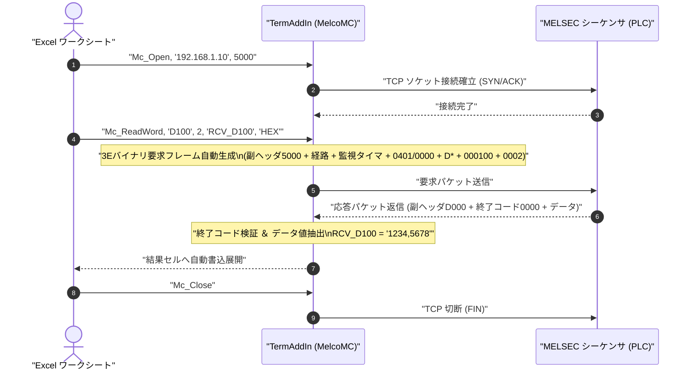



# TermAddIn_MelcoMC - 三菱電機 MELSEC MC プロトコル通信エクステンション

👉 [← TermAddIn 統合本体に戻る](https://github.com/Monaca-App/TermAddIn)  
👉 [← Monaca アプリ工房（トップ）に戻る](https://github.com/Monaca-App/store)

---

[](https://www.microsoft.com/)
[](https://www.microsoft.com/excel)
[](https://dotnet.microsoft.com/)
[]()
[]()

## 📖 概要

**TermAddIn_MelcoMC** は、Excel 総合通信アドイン **TermAddIn** 上で動作する ** 三菱電機 MELSEC MC プロトコル（MELSEC Communication Protocol）専用エクステンション（機能ドメイン単一 DLL）** です。

三菱電機製シーケンサ（MELSEC iQ-R / iQ-F / Q / L / FX シリーズ）の Ethernet 内蔵ポートまたは Ethernet ユニット（RJ71EN71, QJ71E71 等）と、TCP/IP 経由で **QnA 互換 3E フレーム（バイナリ形式）** を用いて高速に直接交信します。

VBA マクロを一切記述することなく、 **標準の `.xlsx`（マクロ無効ブック）形式のままで MELSEC 各種デバイス（D, W, R, ZR, M, X, Y 等）のビット・ワード単位の一括読出・一括書込、および任意サブコマンド送受信** を安全かつ高スループットに実行できます。

> [!NOTE]
> **利用前提とライセンス体系**  
> 本エクステンションは [TermAddIn 本体](https://github.com/Monaca-App/TermAddIn) 上で動作します。  
> TermAddIn ではプロトコル毎に個別ライセンスを設ける体系を採用しており、本機能のご利用には **`TermAddIn_MelcoMC` 個別ライセンス（一括 ¥32,000 / 月額 ¥3,000 / 週額 ¥1,000・税別）** が適用されます（ライセンス未配置・無効時は、Excel アドイン（`TermAddIn`）・`Term.exe` 単体起動ともに 10 分間の期間限定版として動作します）。

---

## ✨ 主な機能・特徴

1. **QnA 互換 3E フレーム（バイナリコード形式）高速交信**
   * 工場ネットワークのデファクトスタンダードである「QnA 互換 3E フレーム（TCP/IP バイナリ交信）」に準拠し、高い転送効率で PLC デバイスへ直接アクセス可能。
2. **アクセス経路・監視タイマの柔軟な動的設定 (`Mc_Mode`)**
   * ネットワーク番号、PC 番号、要求先ユニット I/O 番号、要求先ユニット局番、および応答待機タイムアウトをシーケンスから動的に設定可能。
3. **デバイスコード自動変換パーサー搭載**
   * D（データレジスタ）、W（リンクレジスタ）、R/ZR（ファイルレジスタ）、M/L/F/V（内部リレー）、X（入力）、Y（出力）、B（リンクリレー）、TN/TS（タイマ）、CN/CS（カウンタ）など主要な MELSEC デバイスコードを自動識別し、10進／16進表記を自動変換。
4. **一括読出（0401）/ 一括書込（1401）コマンドの専用最適化**
   * `Mc_ReadWord`, `Mc_WriteWord`, `Mc_ReadBit`, `Mc_WriteBit` により、電文ヘッダ（サブヘッダ、アクセス経路、監視タイマ等）の構築を意識することなく、デバイス名と点数を指定するだけで直感的に制御可能。
5. **任意 MC フレーム送受信（Mc_Send / Mc_Receive）**
   * 9 バイト 3E アクセス経路ヘッダを自動付与して任意の要求ペイロードを送信・受信できる汎用コマンドも標準提供。
6. **Excel 32bit / 64bit 完全動作 ＆ 仮想 PLC スレーブ連携（`TermEmulator` / `c2c` 対応）**
   * .NET Framework 標準マネージド通信基盤により構築されており、Excel 32bit 版・64bit 版の双方で完全動作。さらに **[TermEmulator](https://github.com/Monaca-App/TermEmulator)** の MELSEC MC 3E 仮想スレーブ（本ライセンス共用可）や **[c2c](https://github.com/Monaca-App/c2c)** の TCP プロキシ中継と直結して実機なし検証も可能。

---

## 🔌 提供コマンド一覧（全 9 コマンド）

各コマンドの詳細な構文・パラメータ仕様・記述例は、以下の個別リファレンスをご参照ください。

### 回線制御・通信条件設定コマンド（3 コマンド）

| コマンド名 | 構文概要 | 主な役割・用途 | 詳細マニュアル |
| :--- | :--- | :--- | :---: |
| **`Mc_Open`** | `Mc_Open, "[Host]", "[Port]"` | MC プロトコル通信 TCP ソケットを開設 | [詳細説明](./Manual/MelcoMC/Mc_Open.Md) |
| **`Mc_Close`** | `Mc_Close` | 通信ソケットを安全に切断・リソース解放 | [詳細説明](./Manual/MelcoMC/Mc_Close.Md) |
| **`Mc_Mode`** | `Mc_Mode, "<Option1>", "[Option2]", ...` | アクセス経路（局番・ネットワーク番号等）やタイムアウト設定 | [詳細説明](./Manual/MelcoMC/Mc_Mode.Md) |

### デバイスアクセス・高水準コマンド（4 コマンド）

| コマンド名 | 構文概要 | 主な役割・用途 | 詳細マニュアル |
| :--- | :--- | :--- | :---: |
| **`Mc_ReadWord`** | `Mc_ReadWord, "<Device>", <Points>, "<ResultKey>"` | ワードデバイス一括読出（コマンド 0401 サブ 0000） | [詳細説明](./Manual/MelcoMC/Mc_ReadWord.Md) |
| **`Mc_WriteWord`** | `Mc_WriteWord, "<Device>", "<Values>"` | ワードデバイス一括書込（コマンド 1401 サブ 0000） | [詳細説明](./Manual/MelcoMC/Mc_WriteWord.Md) |
| **`Mc_ReadBit`** | `Mc_ReadBit, "<Device>", <Points>, "<ResultKey>"` | ビットデバイス一括読出（コマンド 0401 サブ 0001） | [詳細説明](./Manual/MelcoMC/Mc_ReadBit.Md) |
| **`Mc_WriteBit`** | `Mc_WriteBit, "<Device>", "<BitValues>"` | ビットデバイス一括書込（コマンド 1401 サブ 0001、カンマ区切り） | [詳細説明](./Manual/MelcoMC/Mc_WriteBit.Md) |

### 汎用 MC フレーム送受信コマンド（2 コマンド）

| コマンド名 | 構文概要 | 主な役割・用途 | 詳細マニュアル |
| :--- | :--- | :--- | :---: |
| **`Mc_Send`** | `Mc_Send, "<HexPayload>"` | 3E ヘッダを自動付与して任意の要求ペイロードを送信 | [詳細説明](./Manual/MelcoMC/Mc_Send.Md) |
| **`Mc_Receive`** | `Mc_Receive, "<ResultKey>", [TimeoutMs]` | MC プロトコル応答フレームを受信・終了コード検証 | [詳細説明](./Manual/MelcoMC/Mc_Receive.Md) |

---

## 💻 動作環境・システム要件

| 項目 | システム要件 |
| :--- | :--- |
| **OS** | Windows 10 / Windows 11 (64bit / 32bit) |
| **対応 Excel** | Microsoft Excel 2016 / 2019 / 2021 / Microsoft 365 (デスクトップ版 32bit / 64bit) |
| **必須アドイン** | [TermAddIn](https://github.com/Monaca-App/TermAddIn) (Excel VSTO アドイン) |
| **対象 PLC** | 三菱電機 MELSEC iQ-R / iQ-F / Q / L / FX シリーズ（内蔵 Ethernet ポート、RJ71EN71、QJ71E71 等） |
| **対応プロトコル** | MELSEC MC プロトコル QnA 互換 3E フレーム（TCP/IP・バイナリ形式） |

---

## 🚀 インストール手順

<a href="https://github.com/Monaca-App/TermAddIn_MelcoMC/raw/main/Setup/TermAddIn_MelcoMC_Setup.zip">
  
</a>

> 上記の **「プログラム（入手）」アイコン** をクリックすると、セットアッププログラム一式（[`TermAddIn_MelcoMC_Setup.zip`](https://github.com/Monaca-App/TermAddIn_MelcoMC/raw/main/Setup/TermAddIn_MelcoMC_Setup.zip)）が直接ダウンロードされます。展開後、`TermAnalysis.MelcoMC\setup.exe`（または `TermAnalysis.MelcoMC.Setup.msi`）を実行してください。

> [!IMPORTANT]
> **導入前提**  
> 本エクステンションを利用するには、事前に **[TermAddIn 本体](https://github.com/Monaca-App/TermAddIn)** （`Term.Setup` および `TermAddIn.Setup`）をインストールしておく必要があります。

### 配布アーカイブ（本リポジトリ `Setup/` 配下）

* **アーカイブ**: [`Setup/TermAddIn_MelcoMC_Setup.zip`](https://github.com/Monaca-App/TermAddIn_MelcoMC/raw/main/Setup/TermAddIn_MelcoMC_Setup.zip)（収録内容: `TermAnalysis.MelcoMC/setup.exe`, `TermAnalysis.MelcoMC/TermAnalysis.MelcoMC.Setup.msi`）

### 導入ステップ

1. **Microsoft Excel** および **Term** をすべて終了します。
2. ダウンロードした **`TermAddIn_MelcoMC_Setup.zip`** を展開し、 **`TermAnalysis.MelcoMC/`** フォルダ内の **`setup.exe`** （または **`TermAnalysis.MelcoMC.Setup.msi`** ）を実行します。
   * ※ 管理者権限（UAC 承認）が必要です。
   * ※ 拡張 DLL は共通インストール先（`C:\Program Files (x86)\Monaca_App_Store\Monaca Common\`）へ配置され、サンプル資材が `C:\Program Files (x86)\Monaca_App_Store\Monaca Sample\MelcoMC\` へ導入されます。
3. インストール完了後、Excel（または `Term.exe`）を起動し、メイン画面の **`[通信モード]`** メニューから **`MELSEC MC`** が選択できることを確認します。

### アンインストール手順
* Windows の「設定」>「アプリ」>「インストールされているアプリ」（または「コントロールパネル」の「プログラムと機能」）から **`TermAnalysis.MelcoMC.Setup`** を選択してアンインストールしてください。

---

## 🔄 通信シーケンスの概要

### ワードデバイス一括読出の流れ



---

## 🔰 シーケンス記述例・同梱サンプル資材（`Sample/MelcoMC/`）

QnA 互換 3E バイナリフレームを用いた MELSEC データレジスタ（D100〜D101）一括読出の構成例です。

```csv
; 1. MELSEC MC プロトコル通信ソケットをオープン（TCP/IP, Port 5000）
,SEQUENCE, 010, Mc_Open, "192.168.1.10", 5000
; 2. 3E バイナリ形式で D100 から 2 ワード一括読出を実行
,SEQUENCE, 020, Mc_ReadWord, "D100", 2, "PLC_D100"
; 3. 通信ソケットをクローズして終了
,SEQUENCE, 030, Mc_Close
,SEQUENCE, 040, Exit
```

### 同梱サンプルマクロ・AI自動生成プロンプト集
QnA 互換 3E フレームの全 9 コマンドに対応した動作確認用マクロスクリプト（CSV）および AI 自動生成プロンプトが **`Sample/MelcoMC/`** に収録されています（インストール時には `C:\Program Files (x86)\Monaca_App_Store\Monaca Sample\MelcoMC\` へ配置され、デスクトップの `Monaca\Sample` ショートカットから参照できます）。

* **[`Sample/MelcoMC/MelcoMC.csv`](./Sample/MelcoMC/MelcoMC.csv)**: MELSEC MC プロトコル（3E フレーム）汎用マクロスクリプトサンプル
* **[`Sample/MelcoMC/MelcoMC_prompt.md`](./Sample/MelcoMC/MelcoMC_prompt.md)**: MELSEC MC プロトコル用マクロスクリプト AI 自動生成プロンプト

---

## 💳 ライセンス・購入プラン（TermAddIn_MelcoMC）

> [!NOTE]
> **試用動作およびオンライン決済について**  
> ライセンス未配置・無効時は、Excel アドイン（`TermAddIn`）・`Term.exe` 単体起動ともに 10 分間の期間限定版として動作します（10 分超過後は未保有機能のみスルー／ロック）。  
> 用途や利用期間に合わせて、一括購入（買い切り）またはサブスクリプション（月額・週額）からお選びいただけます。メールアドレスの誤入力によるライセンス不着を防ぐため、 **事前のメールアドレス確認** を行った上で、 **Stripe** による安全なオンライン決済へご案内いたします（表記価格はすべて税別です）。

| プラン | 価格（税別） | お支払い・お申込み |
| :--- | :---: | :---: |
| **一括購入（買い切りライセンス）**<br>無期限で永続利用できるライセンスです。 | **¥32,000** | [👉 一括購入手続きへ](https://stripe-license-generator.y-nakai-5a3.workers.dev/?target=melcomc) |
| **月額サブスクリプション**<br>月単位で利用できる定期プランです。中長期のプロジェクトにおすすめです。 | **¥3,000** / 月 | [👉 月額プランに申し込む](https://stripe-license-generator.y-nakai-5a3.workers.dev/?target=melcomc) |
| **週額サブスクリプション**<br>週単位で手軽に利用できるプランです。短期評価や単発テストにおすすめです。 | **¥1,000** / 週 | [👉 週額プランに申し込む](https://stripe-license-generator.y-nakai-5a3.workers.dev/?target=melcomc) |

* ※ **ライセンスファイル名**: `TermAddIn_MelcoMC.License`
* ※ **配置先**: `%USERPROFILE%\Desktop\Monaca\TermAddIn_MelcoMC.License`（設定ファイル `Setting.xml` と同階層）
* ※ **ライセンス形態**: 1 ユーザー / 1 PC（ノードロック方式：`PC名` および `ログインユーザー名` に紐づけ）

---

## 📄 ライセンス & サポート

* **開発元**: [Monaca アプリ工房 (Monaca App Store)](https://github.com/Monaca-App/store)
* **親プロジェクト**: [TermAddIn](https://github.com/Monaca-App/TermAddIn)
* **関連ツール・シミュレータ**: [TermEmulator - 汎用仮想デバイス＆PLCスレーブ・エミュレータ](https://github.com/Monaca-App/TermEmulator) ／ [c2c - ドライバ不要の仮想ヌルモデム＆通信モニター](https://github.com/Monaca-App/c2c)
* **Copyright**: Copyright (C) Monaca App Store 2026 All rights reserved.
* **お問い合わせ**: 不具合報告や機能要望は、GitHub の Issue までお気軽にお寄せください。
