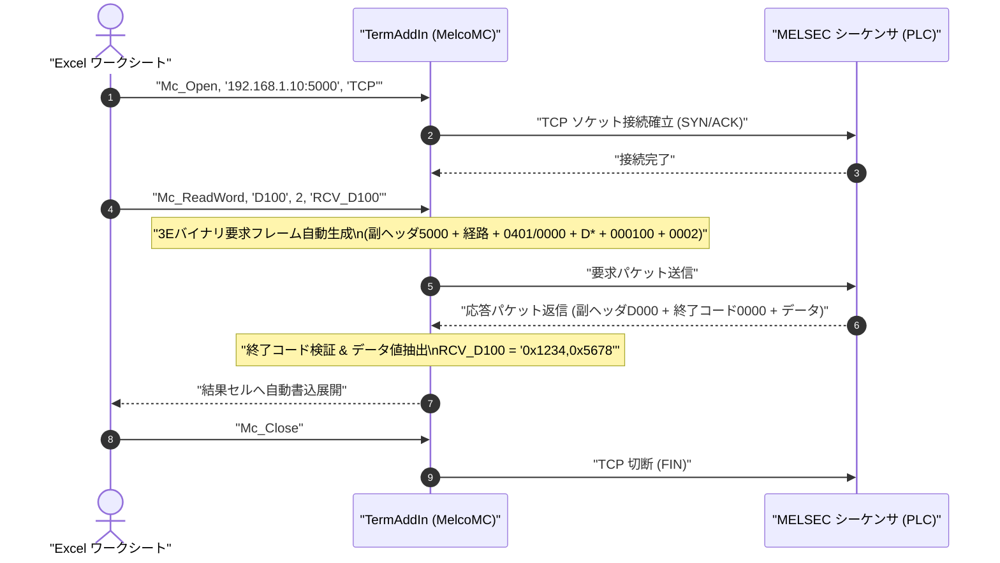



# TermAddIn_MelcoMC - 三菱電機 MELSEC MC プロトコル通信エクステンション

👉 [← TermAddIn 統合本体に戻る](https://github.com/Monaca-App/TermAddIn)  
👉 [← Monaca アプリ工房（トップ）に戻る](https://github.com/Monaca-App/store)

---

[](https://www.microsoft.com/)
[](https://www.microsoft.com/excel)
[](https://dotnet.microsoft.com/)
[]()
[]()

## 📖 概要

**TermAddIn_MelcoMC** は、Excel 総合通信アドイン **TermAddIn** 上で動作する **三菱電機 MELSEC MC プロトコル（MELSEC Communication Protocol）専用エクステンション（機能ドメイン単一 DLL）** です。

三菱電機製シーケンサ（MELSEC iQ-R / iQ-F / Q / L / FX シリーズ）の Ethernet 内蔵ポートまたは Ethernet ユニット（RJ71EN71, QJ71E71 等）と、TCP/IP または UDP/IP 経由で **QnA 互換 3E フレーム（バイナリ / ASCII 形式）** を用いて高速に直接交信します。

VBA マクロを一切記述することなく、 **標準の `.xlsx`（マクロ無効ブック）形式のままで MELSEC 各種デバイス（D, W, R, ZR, M, X, Y 等）のビット・ワード単位の一括読出・一括書込、および任意サブコマンド送受信** を安全かつ高スループットに実行できます。

> [!NOTE]
> **利用前提とライセンス体系**  
> 本エクステンションは [TermAddIn 本体](https://github.com/Monaca-App/TermAddIn) 上で動作します。  
> TermAddIn ではプロトコル毎に個別ライセンスを設ける体系を採用しており、本機能のご利用には **`TermAddIn_MelcoMC` 個別ライセンス（料金未定・準備中）** が適用されます（なお、 **TermAddIn 本体** は現在 **近日公開** であり、全機能を無償でご試用いただける **評価期間は公開時に設定** いたします）。

---

## ✨ 主な機能・特徴

1. **QnA 互換 3E フレーム（バイナリ & ASCII 形式）完全対応**
   * 工場ネットワークのデファクトスタンダードである「QnA 互換 3E フレーム」に完全準拠。転送効率に優れたバイナリコード形式と、ネットワークアナライザでのパケット可視性に優れた ASCII コード形式の双方を動的に切り替えて利用可能。
2. **TCP/IP および UDP/IP のシームレスなサポート**
   * 高信頼なハンドシェイクを要する TCP 通信、および低遅延・高周期データ収集に適した UDP 通信の双方向ソケット通信に対応。
3. **デバイスコード自動変換パーサー搭載**
   * D（データレジスタ）、W（ファイルレジスタ）、R/ZR（ファイルレジスタ）、M/L/F/V（内部リレー）、X（入力）、Y（出力）、B（リンクリレー）、TN/TS（タイマ）、CN/CS（カウンタ）など主要な MELSEC デバイスコードを自動識別し、10進／16進表記を自動変換。
4. **一括読出（0401）/ 一括書込（1401）コマンドの専用最適化**
   * `Mc_ReadWord`, `Mc_WriteWord`, `Mc_ReadBit`, `Mc_WriteBit` により、電文ヘッダ（サブヘッダ、アクセス経路、監視タイマ等）の構築を意識することなく、デバイス名と点数を指定するだけで直感的に制御可能。
5. **任意 MC コマンド送受信（Mc_Send / Mc_Receive）**
   * 0401/1401 以外の独自サブコマンド（アレイ読出、ランダム書込、CPU 状態読出等）を送信・受信可能な汎用コマンドも標準提供。
6. **Excel 32bit / 64bit 完全動作マトリクス**
   * .NET Framework 標準マネージド通信基盤により構築されており、外部の専用ネイティブ DLL に依存しないため、Excel 32bit 版および 64bit 版の双方で制限なく完全動作。

---

## 🔌 提供コマンド一覧（全 9 コマンド）

各コマンドの詳細な構文・パラメータ仕様・記述例は、以下の個別リファレンスをご参照ください。

### 回線制御・通信条件設定コマンド（3 コマンド）

| コマンド名 | 構文概要 | 主な役割・用途 | 詳細マニュアル |
| :--- | :--- | :--- | :---: |
| **`Mc_Open`** | `Mc_Open, "[Host:Port]", "[Protocol]"` | MC プロトコル通信ソケット（TCP/UDP）を開設 | [詳細説明](./Manual/MelcoMC/Mc_Open.Md) |
| **`Mc_Close`** | `Mc_Close` | 通信ソケットを安全に切断・リソース解放 | [詳細説明](./Manual/MelcoMC/Mc_Close.Md) |
| **`Mc_Mode`** | `Mc_Mode, "[Format]", [NetNo], [PcNo]` | フレーム形式（Binary/ASCII）や局番経路設定 | [詳細説明](./Manual/MelcoMC/Mc_Mode.Md) |

### デバイスアクセス・高水準コマンド（4 コマンド）

| コマンド名 | 構文概要 | 主な役割・用途 | 詳細マニュアル |
| :--- | :--- | :--- | :---: |
| **`Mc_ReadWord`** | `Mc_ReadWord, "[Device]", [Points], "[ResultKey]"` | ワードデバイス一括読出（コマンド 0401 サブ 0000） | [詳細説明](./Manual/MelcoMC/Mc_ReadWord.Md) |
| **`Mc_WriteWord`** | `Mc_WriteWord, "[Device]", [Points], "[Data]"` | ワードデバイス一括書込（コマンド 1401 サブ 0000） | [詳細説明](./Manual/MelcoMC/Mc_WriteWord.Md) |
| **`Mc_ReadBit`** | `Mc_ReadBit, "[Device]", [Points], "[ResultKey]"` | ビットデバイス一括読出（コマンド 0401 サブ 0001） | [詳細説明](./Manual/MelcoMC/Mc_ReadBit.Md) |
| **`Mc_WriteBit`** | `Mc_WriteBit, "[Device]", [Points], "[Data]"` | ビットデバイス一括書込（コマンド 1401 サブ 0001） | [詳細説明](./Manual/MelcoMC/Mc_WriteBit.Md) |

### 汎用 MC フレーム送受信コマンド（2 コマンド）

| コマンド名 | 構文概要 | 主な役割・用途 | 詳細マニュアル |
| :--- | :--- | :--- | :---: |
| **`Mc_Send`** | `Mc_Send, "[Cmd]", "[SubCmd]", "[Data]"` | 任意の MC プロトコル要求フレームを生成・送信 | [詳細説明](./Manual/MelcoMC/Mc_Send.Md) |
| **`Mc_Receive`** | `Mc_Receive, "[ResultKey]", [TimeoutMs]` | MC プロトコル応答フレームを受信・終了コード検証 | [詳細説明](./Manual/MelcoMC/Mc_Receive.Md) |

---

## 💻 動作環境・システム要件

| 項目 | システム要件 |
| :--- | :--- |
| **OS** | Windows 10 / Windows 11 (64bit / 32bit) |
| **対応 Excel** | Microsoft Excel 2016 / 2019 / 2021 / Microsoft 365 (デスクトップ版 32bit / 64bit) |
| **必須アドイン** | [TermAddIn](https://github.com/Monaca-App/TermAddIn) (Excel VSTO アドイン) |
| **対象 PLC** | 三菱電機 MELSEC iQ-R / iQ-F / Q / L / FX シリーズ（内蔵 Ethernet ポート、RJ71EN71、QJ71E71 等） |
| **対応プロトコル** | MELSEC MC プロトコル QnA 互換 3E フレーム（TCP/IP、UDP/IP / バイナリ形式、ASCII 形式） |

---

## 🔄 通信シーケンスの概要

### ワードデバイス一括読出の流れ



---

## 🔰 シーケンス記述例・同梱サンプル資材（`Sample/MelcoMC/`）

QnA 互換 3E バイナリフレームを用いた MELSEC データレジスタ（D100〜D101）一括読出の構成例です。

```csv
; 1. MELSEC MC プロトコル通信ソケットをオープン（TCP/IP）
,SEQUENCE, 010, Mc_Open, "192.168.1.10:5000", "TCP"
; 2. 3E バイナリ形式で D100 から 2 ワード一括読出を実行
,SEQUENCE, 020, Mc_ReadWord, "D100", 2, "PLC_D100"
; 3. 通信ソケットをクローズして終了
,SEQUENCE, 030, Mc_Close
,SEQUENCE, 040, Exit
```

### 同梱サンプルマクロ・AI自動生成プロンプト集
QnA 互換 3E フレーム（TCP/UDP・バイナリ/ASCII）の全 9 コマンドに対応した動作確認用マクロスクリプト（CSV）および AI 自動生成プロンプトが **`Sample/MelcoMC/`** に収録されています（Excel リボンの **「マニュアル配置 (`Make_Doc`)」** 実行時には `<設定場所>\Sample\TermAddIn\MelcoMC\` へ自動展開されます）。

* **[`Sample/MelcoMC/MelcoMC.csv`](./Sample/MelcoMC/MelcoMC.csv)**: MELSEC MC プロトコル（3E フレーム）汎用マクロスクリプトサンプル
* **[`Sample/MelcoMC/MelcoMC_prompt.md`](./Sample/MelcoMC/MelcoMC_prompt.md)**: MELSEC MC プロトコル用マクロスクリプト AI 自動生成プロンプト

---

## 💳 ライセンス・購入プラン（TermAddIn_MelcoMC）

> [!NOTE]
> **料金プランおよび正式販売について**  
> 本エクステンション（`TermAddIn_MelcoMC`）の販売料金およびライセンスプラン（買い切り・サブスクリプション）は **現在検討中（未定）** です。  
> 正式な価格およびお申込み受付開始時期が決定次第、本ドキュメントおよび [Monaca アプリ工房ポータル](https://github.com/Monaca-App/store) にてご案内いたします。  
> なお、[TermAddIn 本体](https://github.com/Monaca-App/TermAddIn) は現在 **近日公開** となっており、全機能を無償でご試用いただける **評価期間は公開時に設定** いたします。

| プラン | 価格 | お支払い・お申込み |
| :--- | :---: | :---: |
| **一括購入（買い切りライセンス）**<br>無期限で永続利用できるライセンスです。 | **未定** | 準備中 |
| **月額サブスクリプション**<br>月単位で利用できる定期プランです。中長期のプロジェクトにおすすめです。 | **未定** | 準備中 |
| **週額サブスクリプション**<br>週単位で手軽に利用できるプランです。短期評価や単発テストにおすすめです。 | **未定** | 準備中 |

* ※ **ライセンスファイル名**: `TermAddIn_MelcoMC.License`
* ※ **配置先**: `%USERPROFILE%\Desktop\Monaca\TermAddIn_MelcoMC.License`（設定ファイル `Setting.xml` と同階層）
* ※ **ライセンス形態**: 1 ユーザー / 1 PC（ノードロック方式：`PC名` および `ログインユーザー名` に紐づけ）

---

## 📄 ライセンス & サポート

* **開発元**: [Monaca アプリ工房 (Monaca App Store)](https://github.com/Monaca-App/store)
* **親プロジェクト**: [TermAddIn](https://github.com/Monaca-App/TermAddIn)
* **Copyright**: Copyright (C) Monaca App Store 2026 All rights reserved.
* **お問い合わせ**: 不具合報告や機能要望は、GitHub の Issue までお気軽にお寄せください。
